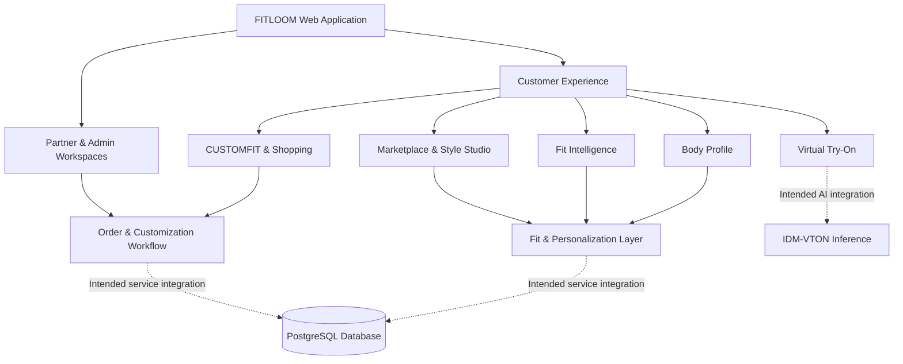

<p align="center">
  
</p>

<h1 align="center">FITLOOM</h1>

<p align="center">
  <strong>AI Fashion Intelligence &amp; Fit Calibration Platform</strong><br />
  <em>Find Your Fit. Define Your Style.</em>
</p>

<p align="center">
  
  
  
</p>

<p align="center">
  
  
  
  
  
  
</p>

---

## Overview

**FITLOOM** is an AI-powered fashion intelligence and fit-calibration platform designed to make online apparel shopping more personal, transparent, and confidence-driven.

Choosing clothes online should be about more than selecting a size label. Different brands use different sizing standards, garments behave differently depending on their construction and fabric, and product photographs rarely explain how an item will fit an individual.

FITLOOM brings together **measurement-based Fit Intelligence**, **AI-assisted Virtual Try-On**, and **personalized fashion discovery** in one connected experience. It helps shoppers understand how a garment may fit, explore how it could look, discover styles that suit them, and move from standard sizing towards customization.

> **Our idea:** combine visual fashion exploration with explainable, measurement-grounded fit guidance—so shoppers can make more informed decisions before they buy.

---

## The Problem

Online fashion shopping still leaves customers answering important questions with guesswork:

- **Unreliable size labels:** A medium in one brand may fit very differently from a medium in another.
- **Limited fit information:** Product images show a garment on a model, but do not explain how it may fit a shopper's own proportions.
- **Uncertain purchase decisions:** Customers often order multiple sizes, abandon purchases, or return products because the fit was not what they expected.
- **Limited personalization:** Generic recommendations rarely account for body measurements, preferred ease, garment dimensions, or fabric behaviour.
- **The gap between ready-made and made-to-measure:** Shoppers who do not fit standard size charts need a clearer path to customization and tailoring.

---

## Our Solution

FITLOOM connects a shopper's body profile, garment information, fit preferences, and visual exploration into a unified fashion experience:

1. **Measure:** Build a structured body profile using key measurements and preferred fit.
2. **Understand fit:** Compare body measurements with garment dimensions, cut, and fabric-related ease to generate a size recommendation with zone-level guidance.
3. **Visualize:** Explore an AI-assisted virtual try-on experience to get a visual reference for an outfit.
4. **Discover:** Explore products, compare garments, create outfits, and save looks.
5. **Customize:** Move beyond standard size labels with CUSTOMFIT and a tailor-oriented workflow.

---

## Core Features

### 1. Body Profile & Fit Calibration

Create a structured body profile with measurements such as:

- Height &amp; weight
- Chest
- Waist
- Hips
- Shoulder width
- Sleeve &amp; inseam length
- Preferred fit and ease (`slim`, `regular`, `relaxed`, `oversized`)

The interface supports centimetre/inch (`cm` / `in`) measurement units, Smart Estimate helpers, and guided measurement entry. Input validation is handled with Zod.

### 2. Fit Intelligence Engine

FITLOOM's central differentiator is its measurement-grounded approach to garment fit.

Instead of relying only on a generic S/M/L label, the Fit Intelligence experience is designed to compare a shopper's measurements with garment-specific size information and fit characteristics.

It provides:

- Recommended garment size
- Fit-confidence and verdict indication
- Zone-wise fit guidance for areas such as chest and waist
- Tight, ideal, or loose fit observations (`Snug`, `Good fit`, `Slightly loose`)
- Fit context informed by garment dimensions, cut, fabric behaviour, and the shopper's preferred ease

The goal is to make recommendations understandable—not just return a size label without explaining the result.

### 3. AI-Assisted Virtual Try-On

The Virtual Try-On experience is designed to help shoppers visually explore how an outfit may look on them:

- Guided image-upload interface
- Virtual fitting-room workflow
- Preview experience with clear demo-state disclosure
- Architecture intended to support an IDM-VTON-based inference integration

**Prototype transparency:** the current repository includes a simulated preview workflow. It does not claim that live AI inference is running in the current demo. Mock previews are not presented as verified AI-generated try-on results.

### 4. Fashion Discovery & Customer Marketplace

Explore a fashion catalogue through an authenticated Marketplace experience (`/shop`) with an on-demand left navigation drawer:

- Product catalogue and protected product detail pages (`/shop/[id]`)
- Live search, category filters (`Shirts`, `Outerwear`, `Trousers`, `T-Shirts`), and fit-type filters (`Slim`, `Regular`, `Relaxed`)
- Garment specifications and size-chart presentation
- Side-by-side product comparison (`/compare`)
- Wishlist and saved-product interactions

### 5. Style Studio & Saved Looks

Build and organize outfit combinations in one place:

- Combine outfit categories such as tops, bottoms, and outerwear
- Explore coordinated looks
- Save outfit combinations
- Revisit saved looks through a dedicated gallery (`/saved-looks`)

### 6. CUSTOMFIT & Multi-Role Workspaces

FITLOOM extends the shopping journey towards made-to-measure fashion and partner operations:

- **CUSTOMFIT (`/customfit`):** Made-to-measure request and configuration experience with customer measurement snapshots.
- **Tailor Workspace (`/tailor*`):** Order queue, customer measurement specs, stage progression, and workshop profile management.
- **Seller Workspace (`/seller*`):** Product catalogue management and standard order fulfillment.
- **Admin Workspace (`/admin*`):** Partner oversight, catalogue moderation, and order monitoring.

### 7. Customer Shopping & Authentication Experience

The prototype also brings together supporting shopping and access-control journeys:

- Split-screen 3D animated `/login` and `/signup` pages with `?next=` destination preservation
- Route-level access protection (`AuthRouteGuard`) restricting product details, cart, wishlist, and workspaces to authenticated sessions
- Separate Customer Dashboard (`/dashboard`), Cart, Checkout, and Order Timeline (`/orders`, `/orders/[id]`)
- Public informational and policy pages (`/about`, `/how-it-works`, `/faq`, `/contact`, `/privacy`, `/terms`, `/returns`, `/shipping`)

---

## What Makes FITLOOM Different?

| Typical online fashion experience | FITLOOM approach |
| --- | --- |
| Depends heavily on standard size labels | Uses body measurements and garment-specific dimensions |
| Shows product images without personalized fit context | Connects visual exploration with fit guidance |
| Gives limited explanation for size choices | Aims to provide zone-level, explainable fit observations |
| Offers generic product discovery | Connects discovery with personal fit preferences and saved outfits |
| Treats customization as a separate journey | Connects fit needs to a CUSTOMFIT and tailor workflow |

**FITLOOM is not just a virtual try-on concept.** Its product direction combines visual exploration with a separate, explainable fit-intelligence layer. A visual preview and a measurement-based fit recommendation serve different purposes, and the platform is designed to make that distinction clear.

---

## Application Routes

The current frontend contains **42 App Router pages**. The routes below describe the available prototype interface; interactive data is currently driven by local mock data and in-memory React state.

| Area | Routes |
| --- | --- |
| **Landing** | `/` |
| **Discovery & Shopping** | `/shop`, `/shop/[id]`, `/compare`, `/wishlist` |
| **Fit & Personalization** | `/body-profile`, `/fit-check`, `/studio`, `/try-on`, `/saved-looks`, `/customfit` |
| **Customer Hub** | `/dashboard`, `/cart`, `/checkout`, `/orders`, `/orders/[id]`, `/account` |
| **Authentication** | `/login`, `/signup`, `/auth/login`, `/auth/register`, `/auth/forgot-password` |
| **Tailor Workspace** | `/tailor`, `/tailor/register`, `/tailor/orders`, `/tailor/orders/[id]`, `/tailor/profile` |
| **Seller Workspace** | `/seller`, `/seller/products`, `/seller/orders` |
| **Admin Workspace** | `/admin`, `/admin/catalogue`, `/admin/orders`, `/admin/partners` |
| **Public Information** | `/about`, `/how-it-works`, `/faq`, `/contact`, `/privacy`, `/terms`, `/returns`, `/shipping` |

---

## Technology Stack

### Frontend

| Technology | Purpose |
| --- | --- |
| [Next.js 15](https://nextjs.org/) | App Router and application framework |
| [React 19](https://react.dev/) | Component-based user interface |
| [TypeScript](https://www.typescriptlang.org/) | Type-safe application development |
| [Tailwind CSS 4](https://tailwindcss.com/) | Utility-first styling |
| [GSAP](https://gsap.com/) | Interface animation and motion |
| [Lenis](https://lenis.darkroom.engineering/) | Smooth scrolling |
| [Lucide React](https://lucide.dev/) | Interface icons |
| [Zod](https://zod.dev/) | Schema and form validation |
| [class-variance-authority](https://cva.style/) | Component variants |
| [clsx](https://github.com/lukeed/clsx) &amp; [tailwind-merge](https://github.com/dcastil/tailwind-merge) | Conditional and conflict-free utility classes |

### Planned Service Integrations

The following technologies represent the intended full-product architecture; they are **not currently connected as live services in this frontend prototype**.

| Technology | Intended purpose |
| --- | --- |
| Next.js Route Handlers &amp; Server Actions | Application APIs and server-side operations |
| [Neon PostgreSQL](https://neon.tech/) | Managed relational database |
| [Drizzle ORM](https://orm.drizzle.team/) | Type-safe database access |
| [Better Auth](https://www.better-auth.com/) | Authentication and session management |
| IDM-VTON | Virtual try-on inference integration; provider and deployment approach to be evaluated |
| [Vercel](https://vercel.com/) | Application hosting and deployment |

---

## High-Level Architecture

The current prototype is a Next.js frontend using local mock datasets and in-memory React state. The intended product architecture connects this experience to persistent services and AI inference.



### Current Prototype Status

To keep the project transparent, the current implementation should be understood as a **frontend prototype**, not a fully deployed production platform:

- The 42-page Next.js interface is implemented in the repository.
- Product, account, order, and other demonstration data are supplied through local mock fixtures.
- `FitloomProvider` manages client-side in-memory state for the demo experience.
- `AuthRouteGuard` enforces client-side route boundaries across guest, customer, seller, tailor, and admin demo roles.
- Zod is used for relevant data and form validation.
- Persistent database storage, production authentication, live backend APIs, and live IDM-VTON inference are not yet connected.

This distinction is intentional: the interface demonstrates the product journey while planned integrations remain clearly identified as future engineering work.

---

## Getting Started

### Prerequisites

- Node.js 20 or later
- npm
- Git

### 1. Clone the repository

```bash
git clone <YOUR_REPOSITORY_URL>
cd FITLOOM
```

### 2. Install dependencies

```bash
npm install
```

### 3. Start the development server

```bash
npm run dev
```

Open [http://localhost:3000](http://localhost:3000) in your browser.

### Available Scripts

| Command | Description |
| --- | --- |
| `npm run dev` | Start the local development server |
| `npm run lint` | Run ESLint checks |
| `npm run build` | Create a production build |
| `npm run start` | Start the production server |

**Environment variables:** the current frontend prototype does not require database credentials, authentication secrets, or AI provider API keys to run.

---

## Repository Structure

```text
FITLOOM/
├── assets/
│   └── fitloom-banner.svg
├── docs/
├── planning/
├── public/
│   └── assets/
│       ├── hero/
│       ├── footer/
│       └── products/
├── src/
│   ├── app/
│   │   ├── page.tsx
│   │   ├── shop/
│   │   ├── body-profile/
│   │   ├── fit-check/
│   │   ├── try-on/
│   │   ├── studio/
│   │   ├── customfit/
│   │   ├── dashboard/
│   │   ├── login/
│   │   ├── signup/
│   │   ├── seller/
│   │   ├── tailor/
│   │   ├── admin/
│   │   └── ...
│   ├── components/
│   │   ├── auth/
│   │   ├── hero/
│   │   ├── home/
│   │   ├── layout/
│   │   ├── providers/
│   │   ├── shop/
│   │   └── ui/
│   └── lib/
│       ├── auth-routes.ts
│       ├── mock-data.ts
│       ├── shop-utils.ts
│       └── utils.ts
├── next.config.ts
├── package.json
└── README.md
```

---

## Team PARADOX

FITLOOM is developed by **Team PARADOX** for **Hack N Pitch — E-Summit '26, Jadavpur University**.

| Team Member |
| --- |
| **MD Danish Raza** |
| **Soumyadeep Dey** |
| **Harshit Raj** |
| **Krishnendu Das** |

---

## Vision

We envision a fashion-shopping experience where customers do not have to guess their size, rely only on generic recommendations, or compromise because standard sizing does not reflect their body.

FITLOOM aims to bring **fit intelligence, visual confidence, personal style, and made-to-measure possibilities** into one connected platform.

**Find Your Fit. Define Your Style.**

---

## Acknowledgements

Built for **Hack N Pitch — E-Summit '26, Jadavpur University** by Team PARADOX.

We acknowledge the open-source communities and projects that support the FITLOOM prototype, including Next.js, React, TypeScript, Tailwind CSS, GSAP, Lenis, Lucide, and Zod, along with the research community behind virtual try-on technologies such as IDM-VTON.

## License

No open-source license has been assigned to this repository yet. All rights remain with the project authors unless a license is added.
