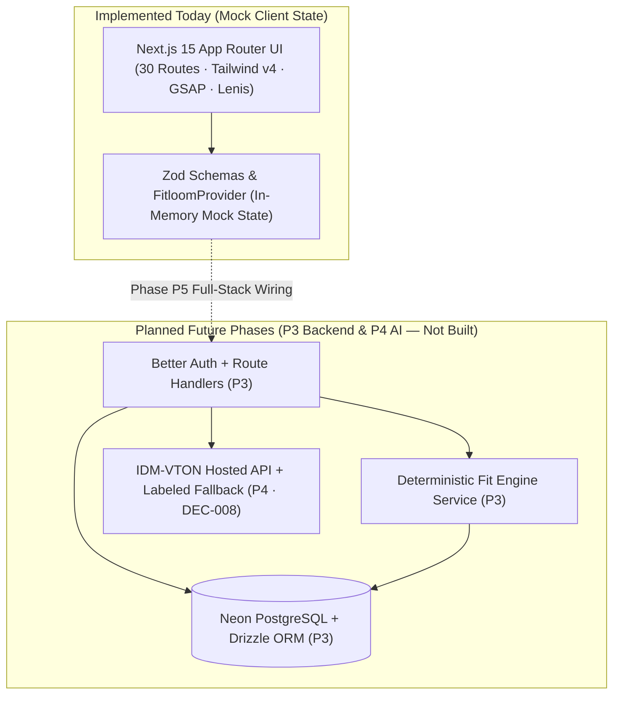

<p align="center">
  
</p>

# FITLOOM

**AI Fashion Intelligence & Fit Calibration Platform**  
*Find Your Fit. Define Your Style.*


> **Current Project Status (`PH0`–`PH2` Completed · Active Frontend Sequence `PH3`–`PH9`):**  
> FITLOOM currently runs as a **Next.js 15 App Router frontend application** powered by **mock data and in-memory React Context (`FitloomProvider`)** across **30 implemented routes**. The **Codebase Audit (`PH0`)**, **Master Tracker Audit & Update (`PH1`)**, **README Audit & Update (`PH2`)**, and **Hero positioning restoration** are complete. Open frontend polish items (20-point checklist), missing UI modules (**Homepage FAQ Preview**, **Global Toasts**, **Cookie Consent Banner**, **Seller/Admin Workspaces**, **Custom 404/Error Boundary**, SEO metadata, and image optimization), and all backend database/auth/AI services (`P3`–`P6`) remain **planned work**.

---

## 1. Project Overview

**FITLOOM** is an **AI Fashion Intelligence and Fit Calibration Platform** developed by **Team PARADOX** for **Hack N Pitch — E-Summit '26, Jadavpur University**.

FITLOOM bridges the gap between online fashion discovery and real-world garment fit by pairing **AI-assisted Virtual Try-On (visual exploration)** with **deterministic, measurement-grounded Fit Intelligence** calibrated against body measurements, garment dimensions, fabric stretch/drape properties, cut profiles, and personal fit preferences.

- **Master Project Tracker (Local Source of Truth):** [`FITLOOM_MASTER_PROJECT_TRACKER.xlsx`](FITLOOM_MASTER_PROJECT_TRACKER.xlsx) *(15 sheets, 102 tracked tasks, 15 logged codebase defects)*
- **Planning & Governance Docs:** [`planning/MASTER_TRACKER_GUIDE.md`](planning/MASTER_TRACKER_GUIDE.md) · [`planning/DECISIONS.md`](planning/DECISIONS.md)
- **External Google Sheet Reference (Initial Hackathon Tracker):** [FITLOOM — Google Sheets Tracker](https://docs.google.com/spreadsheets/d/14kKDELhpmE3QM5h9-ZSIoSWaSsmW2Yc86xPTvliwwIA/edit)

---

## 2. The Real-World Problem & Vision

Online apparel shopping suffers from a persistent **fit-confidence gap**:

- **Inconsistent Sizing Standards:** A tagged size ("M" or "L") varies widely across brands, cuts, and fabric blends.
- **Visual-Only Storefronts:** Studio photography shows how a garment looks on a model, not how it drapes or fits a customer's proportions.
- **Guesswork & Avoidable Returns:** Without zone-level measurement transparency, shoppers guess sizes, bracket-buy multiple variants, or abandon carts.
- **Disconnected Tailoring:** Customers who fall between standard sizes lack a direct workflow from fit diagnostics to made-to-measure adjustments.

### Our Solution & Product Vision

FITLOOM aims to make online garment selection transparent, personalized, and verifiable:

1. **Structured Body Profile (`/body-profile`):** Captures anthropometric measurements (height, chest, waist, hips, shoulder width, and preferred fit ease) validated with `Zod`.
2. **Explainable Fit Intelligence (`/fit-check`):** Compares user measurements against per-size garment dimensions and fabric ease tolerances to output a recommended size, fit confidence percentage, and zone-by-zone guidance (tight / ideal / loose).
3. **AI-Assisted Virtual Try-On (`/try-on`):** Interactive fitting-room workflow designed for async **IDM-VTON** integration in Phase `P4`. Currently runs with **simulated mock previews and explicit Demo disclosures** — FITLOOM never presents mock visuals as live AI inference.
4. **Style Studio & Saved Looks (`/studio`, `/saved-looks`):** Lets users combine tops, bottoms, and outerwear and save coordinated outfits.
5. **CUSTOMFIT & Tailor Workflow (`/customfit`, `/tailor*`):** Connects made-to-measure requests to a dedicated tailor queue with snapshot measurements.

---

## 3. Core Features & Product Modules (Implemented vs. Planned)

> All existing modules currently run on **client-side mock datasets (`src/lib/mock-data.ts`) and in-memory state (`FitloomProvider`)**. Known frontend defects from `PH0` are logged as `BUG-001`–`BUG-015` in `FITLOOM_MASTER_PROJECT_TRACKER.xlsx`.

| Module / Capability | Current Implementation State | Notes & Tracked Work |
| :--- | :--- | :--- |
| **Approved Hero Showcase (`src/components/hero/*`)** | **Completed (Layout Restored)** | Layered responsive hero with individual transparent PNG models, FITLOOM backdrop wordmark, rack, floating outfit selector, flowing graphics, and feature strip (`FL-PH3-002`). Image compression & `HeroNavbar` active-state bug remain open (`PH4`/`PH8`). |
| **Approved Futuristic Footer (`src/components/layout/footer.tsx`)** | **Implemented — Polish Pending (`PH3`, `PH8`)** | Gradient backdrop, oversized FITLOOM wordmark, 4 individual 3D transparent garments, orbit trails, flowing purple waves, and nav columns preserved. Dynamic copyright year (`FL-CHK-16`), `<Image>`/lazy loading (`FL-CHK-14`), and Cookie Settings trigger (`FL-PH7-002`) pending. |
| **Homepage Middle Content & Selected FAQ (`/`)** | **In Progress (`PH3`)** | Middle showcase, Quick Fit preview, CORE_MODULES, and journey cards implemented (`src/app/page.tsx`). Needs `Badge` token fix, cleanup of `FE-xxx` dev labels, tablet `lg:grid-cols-7` fix, and **new Selected FAQ Preview section (`FL-PH3-001`)**. |
| **Shared UI System, Navbar & Toasts** | **In Progress (`PH4`)** | `RadialBackground`, `Navbar`, and `HeroNavbar` (clickable logo verified `FL-CHK-06`) implemented. **Fixes pending:** undefined `Badge` Tailwind tokens (`BUG-001`), `Button` `whitespace-nowrap` overflow (`BUG-006`), false `Shop` underline on `/` + role-hardcoded mobile drawers (`BUG-004`), and **Global Toast System (`FL-PH4-001`, not yet built)**. |
| **Body Profile & Calibration (`/body-profile`)** | **In Progress (`PH5`)** | Interactive measurement calibration with `cm`/`in` toggle & Smart Estimate implemented (`Zod` validated). Needs smooth inch-input editing (`BUG-014`), dynamic step state, save toast, and digital proportion preview polish (`FL-P2-006`). |
| **Fit Intelligence Engine (`/fit-check`)** | **In Progress (`PH5`)** | Client-side mock calculation outputs size recommendation, confidence score, and chest/waist/hip/length zone breakdown. Pending `?product=` query hydration (`BUG-005`), `Badge` token fix, and future backend service (`BE-007` in `P3`). |
| **Shop, Product Details & Compare (`/shop`, `/shop/[id]`, `/compare`)** | **In Progress (`PH5`)** | Catalogue filters/search, product spec + size chart, and multi-garment comparison implemented. Pending invalid-ID `[0]` fallback removal (`BUG-003`), mobile Size Chart scroll/375px layout fixes (`BUG-006`), and action toasts. |
| **Style Studio, Try-On UI & Saved Looks (`/studio`, `/try-on`, `/saved-looks`)** | **In Progress (`PH5`)** | Outfit composer, upload dropzone (MIME + 8 MB check), async preview simulator, and Saved Looks gallery exist. Pending `?look=` / `?product=` query wiring (`BUG-005`), real uploaded photo object-URL preview & removal of exposed debug button (`BUG-012`), and live **IDM-VTON** integration (`P4`). |
| **CUSTOMFIT & Cart/Checkout/Orders (`/customfit`, `/cart`, `/checkout`, `/orders*`)** | **In Progress (`PH5`)** | Made-to-measure configurator, cart calculations, checkout form, and order timeline exist. **Critical fixes pending:** block empty-cart phantom `₹1,499` order creation (`BUG-002`), remove `?? orders[0]` fallback (`BUG-003`), wire `?new=1` & `/orders` empty state (`BUG-015`). |
| **Tailor Workspace (`/tailor*`)** | **In Progress (`PH6`)** | Dashboard, onboarding (`/tailor/register`), order queue, order detail, and profile routes implemented with mock CUSTOMFIT queue. Pending role guards on 3 sub-routes (`BUG-007`), `?? orders[0]` removal, 375px `grid-cols-3`/header fixes (`BUG-006`), and capacity validation. |
| **Seller & Admin Workspaces** | **Planned (`PH6`) — Not Implemented** | `0` seller or admin routes/UI components exist yet. Exact routes and MVP scope await Project Owner confirmation under `DEC-010`. |
| **Public Pages, FAQ, Cookie Banner & Compliance UI** | **In Progress / Planned (`PH7`)** | `/faq`, `/privacy`, `/terms`, `/contact`, `/about`, `/how-it-works` exist as initial routes needing `FE-xxx`/placeholder cleanup, `tel:`/`mailto:`, and `scroll-mt-24`. **Cookie Consent Banner & Preference UI (`FL-PH7-002`) is not yet implemented.** |
| **20-Point Polish, Custom 404, Error Boundary, SEO & Images** | **In Progress / Planned (`PH8`)** | Custom `src/app/not-found.tsx` (`FL-CHK-12`), runtime `src/app/error.tsx` (`FL-PH8-001`), per-route SEO titles/descriptions (`FL-CHK-17/18`), `next/image` migration & ~14.6 MB hero/footer PNG compression (`FL-CHK-14`), and dynamic footer copyright year (`FL-CHK-16`) remain pending. |
| **Backend APIs, Database, Auth & Live AI** | **Future Phases (`P3`–`P4`) — Not Implemented** | Neon PostgreSQL, Drizzle ORM, Better Auth, Next.js Route Handlers, and live IDM-VTON inference have not started. |

---

## 4. User Roles Matrix (Implemented vs. Planned)

`FitloomProvider` (`src/components/providers/fitloom-provider.tsx`) currently defines `MockRole = "guest" | "customer" | "tailor"`:

| Role | Tracker / Code Status | Current Capabilities & Gaps |
| :--- | :--- | :--- |
| **Guest (`guest`)** | **Implemented (Mock)** | Can browse public catalogue/info routes and preview interactive modules. Note: role guards on `/orders/[id]` and `/tailor/orders*` are missing (`BUG-007`). |
| **Customer (`customer`)** | **Implemented (Mock)** | Mock sign-in/demo switch (`/auth/login`, `/account`) unlocks Customer Dashboard (`/dashboard`), Body Profile calibration, Fit Check, Style Studio, Try-On UI, CUSTOMFIT, Cart/Checkout, Orders, Wishlist, Compare, and Saved Looks. |
| **Tailor (`tailor`)** | **Implemented (Mock UI)** | `/tailor` portal, `/tailor/register`, `/tailor/orders`, `/tailor/orders/[id]`, `/tailor/profile` exist for accepting/advancing CUSTOMFIT orders and inspecting customer measurements. Sub-route role guards, 375px layout fixes, and capacity validation are pending in `PH6`. |
| **Seller** | **Planned (`PH6`) — Not Implemented** | Planned merchant/brand workspace for catalogue, size chart, inventory, and standard order management (`FL-PH6-001`, pending `DEC-010`). |
| **Admin** | **Planned (`PH6`) — Not Implemented** | Planned platform moderation, tailor/seller verification, and system oversight views (`FL-PH6-002`, pending `DEC-010`). |

---

## 5. Actual Implemented Routes & Planned Page Structure

Unlike the early Phase 0 draft routes, the actual `Next.js 15` App Router implementation under `src/app/` contains **30 routes**:

### Implemented Frontend Routes (30 Routes — Mock / Local State)

| Category | Route | Page File | Current State |
| :--- | :--- | :--- | :--- |
| **Landing** | `/` | `src/app/page.tsx` | Restored Hero & Footer; middle sections need FAQ preview (`FL-PH3-001`) & polish |
| **Discovery & Shopping** | `/shop` | `src/app/shop/page.tsx` | Product catalogue grid, filters, search (`BUG-011/012/015` open) |
| | `/shop/[id]` | `src/app/shop/[id]/page.tsx` | Product details & size chart (`?? [0]` fallback `BUG-003`; 375px overflow `BUG-006`) |
| | `/compare` | `src/app/compare/page.tsx` | Side-by-side garment matrix (scroll cue & deep-link fixes pending) |
| | `/wishlist` | `src/app/wishlist/page.tsx` | Saved shortlist (`toast` feedback pending) |
| **Fit, AI & Customizing** | `/body-profile` | `src/app/body-profile/page.tsx` | Body measurement calibration (`in` keystroke rounding `BUG-014`; avatar polish) |
| | `/fit-check` | `src/app/fit-check/page.tsx` | Fit Intelligence calibration & zone results (`?product=` ignored `BUG-005`) |
| | `/studio` | `src/app/studio/page.tsx` | Style Studio outfit composer (`?look=` ignored `BUG-005`; header wrap) |
| | `/try-on` | `src/app/try-on/page.tsx` | Simulated VTON upload/preview (`?product=`, grey preview box, debug btn `BUG-012`) |
| | `/customfit` | `src/app/customfit/page.tsx` | Made-to-measure request flow (`?product=` ignored `BUG-005`; 375px buttons) |
| **Customer Hub** | `/dashboard` | `src/app/dashboard/page.tsx` | Customer overview (`92%` accuracy hardcoded `BUG-014`; `flex-wrap`) |
| | `/saved-looks` | `src/app/saved-looks/page.tsx` | Saved outfits gallery (`Open in Studio` omits `?look=`) |
| | `/cart` | `src/app/cart/page.tsx` | Shopping cart quantity & totals (`toast` feedback pending) |
| | `/checkout` | `src/app/checkout/page.tsx` | Mock checkout (**Critical:** empty-cart phantom order `BUG-002`) |
| | `/orders` | `src/app/orders/page.tsx` | Customer order list (missing empty state & role guard) |
| | `/orders/[id]` | `src/app/orders/[id]/page.tsx` | Order timeline & cancel/return (`?? orders[0]` `BUG-003`; `?new=1` ignored) |
| **Auth & Account** | `/auth/login` | `src/app/auth/login/page.tsx` | Mock sign-in UI |
| | `/auth/register` | `src/app/auth/register/page.tsx` | Mock registration UI |
| | `/account` | `src/app/account/page.tsx` | Account metadata & mock role switcher |
| **Tailor Workspace** | `/tailor` | `src/app/tailor/page.tsx` | Tailor dashboard summary (role-guarded) |
| | `/tailor/register` | `src/app/tailor/register/page.tsx` | Tailor onboarding form (mock role switch) |
| | `/tailor/orders` | `src/app/tailor/orders/page.tsx` | Tailor CUSTOMFIT order queue (guard & filtered empty state missing) |
| | `/tailor/orders/[id]` | `src/app/tailor/orders/[id]/page.tsx` | Order measurements & stage actions (`?? [0]`, guard & `grid-cols-3` overflow) |
| | `/tailor/profile` | `src/app/tailor/profile/page.tsx` | Workshop settings (guard, 375px header overflow, local-only capacity) |
| **Public & Compliance** | `/faq` | `src/app/faq/page.tsx` | Dedicated FAQ page (`FE-025` badge cleanup & Homepage sync pending) |
| | `/privacy` | `src/app/privacy/page.tsx` | Draft Privacy Policy (`PH7` cookie/telemetry disclosure update pending) |
| | `/terms` | `src/app/terms/page.tsx` | Draft Terms of Service (`FE-025 · Legal Placeholder` copy cleanup pending) |
| | `/contact` | `src/app/contact/page.tsx` | Contact form & `#socials` (`tel:`/`mailto:`, placeholder text & `scroll-mt-24` pending) |
| | `/about` | `src/app/about/page.tsx` | About & Team PARADOX (`scroll-mt-24` & `FE-025` cleanup pending) |
| | `/how-it-works` | `src/app/how-it-works/page.tsx` | Platform technology walkthrough (`scroll-mt-24` & `FE-025` cleanup pending) |

### Planned Routes & System UI Components (Not Yet Created)
- **Seller & Admin Workspaces (`PH6`):** Dedicated Seller and Admin routes/portals (awaiting `DEC-010`).
- **Compliance & Utility Boundaries (`PH4` / `PH7` / `PH8`):** Cookie Consent Banner (`src/components/layout/cookie-banner.tsx`), Global Toast Viewport (`src/components/ui/toast.tsx`), Branded Custom 404 (`src/app/not-found.tsx`), Runtime Error Boundary (`src/app/error.tsx`).

---

## 6. Architecture & Technology Stack

### Current Frontend Architecture (Implemented)

- **Framework:** Next.js `^15.2.0` App Router + React `^19.0.0` + TypeScript `^5.7.3` (currently 26 Client Component routes + Server Components `/about`, `/how-it-works`, `/privacy`, `/terms`; all 30 routes currently inherit root `src/app/layout.tsx` metadata until per-route SEO titles/descriptions are added in `PH8`).
- **Styling & Visual System:** Tailwind CSS `^4.0.9` with `RadialBackground` (`#6633EE` violet accent), `class-variance-authority`, `clsx`, `tailwind-merge`, and `lucide-react` icons.
- **Motion:** `lenis` (`^1.1.20`) smooth scroll wrapper, `gsap` (`^3.12.7`), and CSS footer animations respecting `prefers-reduced-motion`.
- **State & Validation (Frontend-Only):** `FitloomProvider` manages `user`, `bodyProfile`, `cart`, `wishlist`, `compareIds`, `savedLooks`, and `orders` purely in React state using typed mock fixtures and `Zod` schemas (`src/lib/mock-data.ts`). **Zero backend APIs, database connections, or persistent server sessions exist yet.**

### Approved vs. Planned Full-Stack Architecture (`DEC-006`)



| Layer | Technology | Status in Codebase |
| :--- | :--- | :--- |
| **UI & Routing** | Next.js `^15.2.0` App Router, React `^19.0.0`, TypeScript `^5.7.3`, Tailwind CSS `^4.0.9` | **Installed & Active** |
| **Animation & Icons** | `gsap` (`^3.12.7`), `lenis` (`^1.1.20`), `lucide-react` (`^0.475.0`) | **Installed & Active** |
| **Validation** | `zod` (`^3.24.2`) | **Installed & Active** (`BodyProfileSchema` & form checks) |
| **Toast / Cookie Banner / 404 / Error** | Minimal custom zero-dependency React components (`DEC-002` Ponytail) | **Planned (`PH4` / `PH7` / `PH8`)** |
| **Backend APIs & Auth** | Next.js Route Handlers, Server Actions, Better Auth | **Planned (`P3` — Not Installed)** |
| **Database & ORM** | Neon PostgreSQL, Drizzle ORM | **Planned (`P3` — Not Installed)** |
| **AI Virtual Try-On** | IDM-VTON (hosted inference provider pending evaluation under `DEC-008`) | **Planned (`P4` — Currently Simulated Preview Only)** |
| **Production Hosting** | Vercel | **Planned (`P6`)** |

---

## 7. Planned FAQ, Cookie Consent & Compliance Roadmap

Public and legal placeholder routes (`/faq`, `/privacy`, `/terms`, `/contact`, `/about`, `/how-it-works`) currently exist in `src/app/` and require content/compliance alignment before release:

- **Homepage Selected FAQ Preview (`PH3` / `FL-PH3-001`):** Curated top Q&As in the homepage middle section linking to `/faq` while preserving Hero and Footer.
- **Dedicated FAQ (`/faq`) Sync (`PH7` / `FL-PH7-001`):** Synchronize answers with homepage FAQs, clarify VTON AI vs. Fit Intelligence boundaries, and remove `FE-025` internal badges.
- **Cookie Consent Banner (`PH7` / `FL-PH7-002`):** Implement a non-intrusive consent banner + Customize Preferences panel (`Accept All`, `Essential Only`, category controls persisted in `localStorage`) with a Footer `"Cookie Settings"` trigger.
- **Privacy Policy (`/privacy`) & Terms (`/terms`) (`PH7` / `FL-PH7-003`, `FL-PH7-004`):** Replace placeholder/dev copy, document local mock storage vs. planned Body Profile/VTON image retention rules, and match Cookie Consent categories.
- **Contact Links & Placeholder Cleanup (`PH7`–`PH8`):** Wrap support contact details with clickable `tel:` and `mailto:` links, clean `#socials` placeholder copy, and switch footer copyright (`footer.tsx:252`) to dynamic year rendering (`FL-CHK-16`).

---

## 8. Development Roadmap & Phase Sequence (`PH0`–`PH9` + Downstream)

FITLOOM follows a strict sequential recovery and completion roadmap tracked in [`FITLOOM_MASTER_PROJECT_TRACKER.xlsx`](FITLOOM_MASTER_PROJECT_TRACKER.xlsx):

| Phase ID | Phase Name | Status | Scope / Exit Focus |
| :--- | :--- | :--- | :--- |
| **`PH0`** | **Codebase Audit** | **Completed & Approved** | 20-point inspection across 30 routes, components, & assets; 15 defects (`BUG-001`–`015`) logged. |
| **`PH1`** | **Project Tracker Audit & Update** | **Completed & Approved** | Updated `FITLOOM_MASTER_PROJECT_TRACKER.xlsx` across 15 sheets, 102 tasks, and 20 checklist items. |
| **`PH2`** | **README Audit & Update** | **Completed** *(Current Deliverable)* | Align `README.md` accurately with implemented codebase, roadmap, mock architecture, & planned work. |
| **`PH3`** | **Homepage Completion** | **In Progress** (`1/4` tasks) | Preserve restored Hero & Footer; complete middle content cleanup & add Selected FAQ Preview section. |
| **`PH4`** | **Shared UI Foundations & Navigation** | **In Progress** (`0/4` tasks) | Fix `Badge` tokens & `Button` wrapping, add global Toast system, fix `HeroNavbar`/mobile drawers, add `scroll-mt-24`. |
| **`PH5`** | **Core Customer Frontend** | **In Progress** (`0/13` tasks) | Fix checkout empty-cart bug, `[0]` detail fallbacks, `?product=`/`?look=`/`?new=1` params, `/body-profile` inches editing, `/dashboard` live metric & digital avatar polish. |
| **`PH6`** | **Seller, Tailor & Admin Workspaces** | **In Progress** (`0/3` tasks) | Fix `/tailor*` guards & 375px overflows; build mock **Seller** and **Admin** workspace views (after `DEC-010`). |
| **`PH7`** | **Public Pages & Compliance UI** | **In Progress** (`0/6` tasks) | Build **Cookie Consent Banner** (`FL-PH7-002`); align `/faq`, `/privacy`, `/terms`, `/contact`, `/about`, `/how-it-works`. |
| **`PH8`** | **Frontend Completion & Polish** | **In Progress** (`2/22` tasks) | Complete all 20 checklist items (`FL-CHK-01`–`20`), `not-found.tsx`, `error.tsx`, per-route SEO metadata, `next/image` compression, placeholder cleanup, & dynamic copyright. |
| **`PH9`** | **Final Full Frontend Testing** | **Pending** (`0/6` tasks) | Mobile/tablet/desktop responsiveness, all 30+ routes, customer/professional flows, forms/toasts, cookie prefs & Hero/Footer visual lock gate. |
| **`P0`** | *Legacy Initial Identity Baseline* | *Historical (`2/4` Done)* | `assets/fitloom-banner.svg` (`FL-P0-001`) + initial v0.1 README baseline (`FL-P0-002`). |
| **`P1`** | Technical Documentation (`docs/`) | **Pending** (`0/8` tasks) | PRD, functional/NFR specs, DB/ER diagrams, API contracts, AI Fit spec, Security/Privacy & QA docs (`docs/` not yet created). |
| **`P3`** | Backend & Database | **Pending** (`0/11` tasks) | Neon PostgreSQL, Drizzle schema/migrations, Better Auth, Fit Engine service, Zod-validated Route Handlers. |
| **`P4`** | AI Integration (IDM-VTON) | **Pending** (`0/6` tasks) | Provider evaluation (`DEC-008`), EXIF/upload validation, async VTON pipeline, Fit+AI synergy & labeled Fallback. |
| **`P5`** | Full-Stack Integration & E2E QA | **Pending** (`0/6` tasks) | Wire frontend to live `P3`/`P4` APIs, execute full-stack E2E/security/performance QA & resolve remaining bugs. |
| **`P6`** | Deployment & Final Presentation | **Pending** (`0/6` tasks) | Vercel production setup, seeded Neon demo dataset, offline backup recording, Hack N Pitch deck & rehearsals. |

### 36-Hour Hackathon MVP vs. Post-Hackathon Full Product Scope

- **36-Hour Hackathon MVP Target:** Core customer shopper journey (Hero showcase, Body Profile calibration, Shop & Product Details, Fit Intelligence Check, Style Studio, Simulated/Real VTON preview with explicit fallback badge, Saved Looks, Shopping Cart/Checkout), deterministic Fit Engine + core Neon/Drizzle/Better Auth APIs, Vercel deployment, offline backup demo, and Hack N Pitch presentation.
- **Post-Hackathon / Stretch Scope:** Full fulfillment depth for **Tailor, Seller & Admin Workspaces**, advanced multi-garment CUSTOMFIT pattern workflows, 3D mesh/avatar reconstruction, automated CI/CD, and public release packaging.

---

## 9. Repository Structure & Local Setup

### Current Directory Structure

```text
FITLOOM/
├── assets/
│   └── fitloom-banner.svg                        # Animated SVG brand banner for README
├── planning/                                     # Governance docs, tracker guide, decisions, status
├── public/
│   └── assets/
│       ├── hero/                                 # Approved Hero transparent PNGs & models
│       ├── footer/                               # Approved 3D Footer transparent garment PNGs
│       └── products/                             # Garment imagery for mock Shop catalogue
├── src/
│   ├── app/                                      # 30 Next.js App Router pages + icon.svg + globals.css
│   ├── components/
│   │   ├── hero/                                 # FitloomHero, BrandBackdrop, HeroModels, OutfitSelector, etc.
│   │   ├── layout/                               # Navbar, Footer, MainShell
│   │   ├── providers/                            # FitloomProvider (mock state), LenisProvider
│   │   └── ui/                                   # Badge, Button, Card, Input, Tabs, RadialBackground
│   └── lib/
│       ├── mock-data.ts                          # Zod schemas, fit algorithm mock helpers & garment fixtures
│       └── utils.ts                              # cn() Tailwind class helper
├── FITLOOM_MASTER_PROJECT_TRACKER.xlsx           # Master Excel project tracker (15 sheets)
├── next.config.ts                                # Next.js config (reactStrictMode: true)
├── package.json                                  # Frontend dependencies & npm scripts
└── README.md
```

### Local Setup & Running the Frontend Prototype

**Prerequisites:** Node.js (v20+ recommended; `@types/node` `^22.13.5` configured) and `npm`.  
*(No environment variables, `.env` secrets, PostgreSQL connection strings, or IDM-VTON API keys are needed yet — the current frontend runs entirely on local mock data.)*

1. **Navigate to the project root** (where `package.json` resides) and install dependencies:
   ```bash
   npm install
   ```
2. **Start the local development server:**
   ```bash
   npm run dev
   ```
   Open `http://localhost:3000` in your browser.
3. **Other available scripts (`package.json`):**
   - `npm run lint` — Run ESLint checks
   - `npm run build` — Build production Next.js bundle *(deferred until PH9 QA gate)*
   - `npm run start` — Serve production build after `npm run build`

---

## 10. Team PARADOX & Current Project Metrics

| Member | Role | Status |
| :--- | :--- | :--- |
| **MD Danish Raza** | `TBD` *(Pending `DEC-007`)* | Active |
| **Soumyadeep Dey** | `TBD` *(Pending `DEC-007`)* | Active |
| **Harshit Raj** | `TBD` *(Pending `DEC-007`)* | Active |
| **Krishnendu Das** | `TBD` *(Pending `DEC-007`)* | Active |

- **Current Phase:** **`PH2` README Audit & Update Complete** — Next up: **`PH3` Homepage Completion** (after gate review).
- **Master Tasks (`01_MASTER_TASKS`):** `8 / 102` Completed (`37` In Progress, `57` Pending, `0` Blocked).
- **Open Decisions Requiring Team / Owner Input (`12_DECISION_LOG`):**
  - `DEC-007`: Confirm Team PARADOX role assignments (`TBD` owners across tasks)
  - `DEC-008`: Evaluate & select hosted IDM-VTON provider (`P4`)
  - `DEC-010`: Confirm Seller & Admin Workspace routes and MVP depth (`PH6`)

---

## 11. Development Workflow & Quality Principles

FITLOOM follows the **Ponytail Minimalist Workflow** ([`planning/EXECUTION_RULES.md`](planning/EXECUTION_RULES.md)):

1. Keep solutions simple, CPU-friendly, and free of unnecessary external dependencies.
2. Preserve approved **Hero** and **Footer** visual compositions across frontend polish phases.
3. Never mask layout bugs with blanket CSS hiding or silently ship AI mock outputs without clear Demo badges.
4. Keep task statuses, evidence, and defect logs synchronized in [`FITLOOM_MASTER_PROJECT_TRACKER.xlsx`](FITLOOM_MASTER_PROJECT_TRACKER.xlsx).

---

## 12. License & Acknowledgements

- **License:** **To Be Determined (TBD).** No formal license file has been added yet.
- **Acknowledgements:** Hack N Pitch — E-Summit '26 (Jadavpur University), Team PARADOX, and the open-source communities behind Next.js, React, Tailwind CSS, GSAP, Lenis, Lucide, Zod, and IDM-VTON research.
