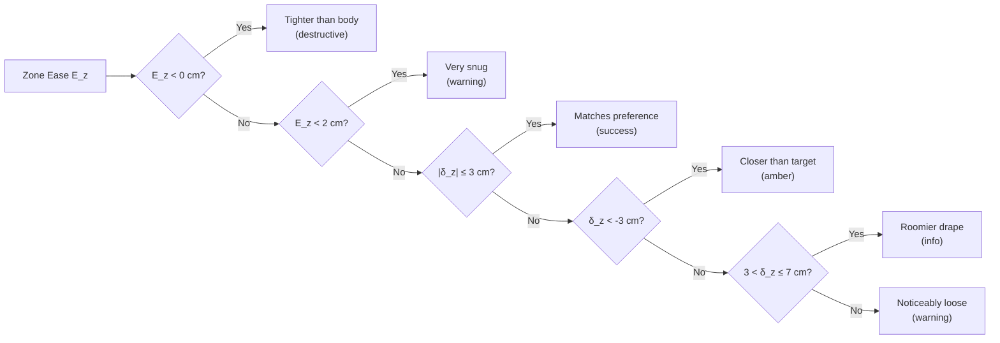

# FITLOOM — Fit Scoring Methodology & Deterministic Calibration Engine

**Document Reference:** `FL-METH-SCORING-001`  
**Governing Module:** Fit Intelligence Engine (`frontend/src/lib/fit-intelligence-utils.ts`, `docs/AI_AND_FIT_SPEC.md`)  
**Repository Path:** `Research/Fit_Scoring_Methodology.md`  
**Prerequisite Specification:** [`Research/measurement_Schema.md`](./measurement_Schema.md)  
**Author / Engineering Lead:** Soumyadeep Dey (`TM-002`)  
**Project:** FITLOOM (Hack N Pitch — E-Summit '26, Jadavpur University)  
**Status:** Canonical Engineering Specification (`FIT_SCORING_METHODOLOGY.md`)

---

## Executive Mandate: Absolute Explainability

In accordance with FITLOOM Engineering Rule `DEC-005` and the Team PARADOX Charter:
> **The Fit Intelligence Engine strictly prohibits black-box heuristic percentages, stochastic approximations, or statistical guesses.**
> Every score, size recommendation, zone verdict, and alternative proposal must be backed by **deterministic geometric calculations, explicit pattern-ease assumptions, and transparent mathematical formulas**.

If garment specifications are missing, the engine **never invents dimensions**; it halts with an honest, audited status code (`missing_garment_measurements`).

---

## 1. Mathematical Fundamentals & Input Vectors

### 1.1 Vector Definitions
For any user and garment pair:
1. **User Body Vector ($\vec{B}$):**
   $$\vec{B} = \left[ B_{\text{chest}}, B_{\text{waist}}, B_{\text{hip}}, B_{\text{shoulder}}, B_{\text{sleeve}}, B_{\text{inseam}} \right]^T \in \mathbb{R}^6_{>0}$$
   All components are canonical metric centimeters ($\text{cm}$) with $0.1\text{ cm}$ precision.

2. **Garment Dimension Matrix ($\mathbf{G}$):**
   For candidate size $s \in \mathcal{S} = \{\text{XS}, \text{S}, \text{M}, \text{L}, \text{XL}, \text{XXL}, \text{3XL}\}$:
   $$\vec{G}(s) = \left[ G_{\text{chest}}(s), G_{\text{waist}}(s), G_{\text{hip}}(s), G_{\text{shoulder}}(s), G_{\text{sleeve}}(s), G_{\text{inseam}}(s) \right]^T$$

3. **Active Fit Preference & Target Ease ($E_{\text{target}}$):**
   Selected by user or overridden per session:
   $$E_{\text{target}} \in \{ +5.0\text{ cm (slim)}, +8.0\text{ cm (regular)}, +12.0\text{ cm (relaxed)}, +15.0\text{ cm (oversized)} \}$$

### 1.2 Category Topology & Anchor Assignment

| Garment Category | Primary Anchor ($p$) | Secondary Anchor ($q$) | Disregarded Dimensions ($\mathcal{D}_{\text{ex}}$) |
| :--- | :--- | :--- | :--- |
| **Shirts / T-Shirts / Hoodies** | Chest ($B_{\text{chest}}$ vs $G_{\text{chest}}$) | Waist ($B_{\text{waist}}$ vs $G_{\text{waist}}$) | Inseam (`not_applicable`) |
| **Outerwear / Jackets** | Chest ($B_{\text{chest}}$ vs $G_{\text{chest}}$) | Waist & Shoulder | Inseam (`not_applicable`) |
| **Trousers / Jeans / Shorts** | Waist ($B_{\text{waist}}$ vs $G_{\text{waist}}$) | Hip & Inseam | Chest, Shoulder, Sleeve (`not_applicable`) |

---

## 2. Garment Ease Mechanics & Target Desired Dimensions

### 2.1 Actual Ease Calculation
For any anatomical zone $z$ on candidate size $s$:
$$E_z(s) = \text{round}_1\left( G_z(s) - B_z \right)$$
where $\text{round}_1(x) = \frac{\lfloor 10x + 0.5 \rfloor}{10}$.

### 2.2 Desired Primary Circumference ($G_{\text{desired}}$)
The ideal garment dimension for the primary anchor zone is:
$$G_{\text{desired}} = \text{round}_1\left( B_p + E_{\text{target}} \right)$$

---

## 3. Candidate Evaluation Pipeline

```
            User Profile Vector B  +  Garment Size Matrix G(s)
                                     │
                                     ▼
                ┌─────────────────────────────────────────┐
                │        Phase 1: Wearability Filter       │
                │        E_p(s) ≥ 0  AND  E_q(s) ≥ 0       │
                └────────────────────┬────────────────────┘
                                     │
                    ┌────────────────┴────────────────┐
                    │                                 │
           [No Wearable Sizes]               [Wearable Set S_wear]
                    │                                 │
                    ▼                                 ▼
         Trigger CUSTOMFIT Tailoring     ┌─────────────────────────┐
         (status: no_supported_rec)     │  Phase 2: Target Delta  │
                                         │  Δ(s) = |G_p(s) - G_des|│
                                         └────────────┬────────────┘
                                                      │
                                                      ▼
                                         ┌─────────────────────────┐
                                         │ Phase 3: Ranking Engine │
                                         │ 1. Ascending Δ(s)       │
                                         │ 2. Descending E_p(s)    │
                                         └────────────┬────────────┘
                                                      │
                                                      ▼
                                         ┌─────────────────────────┐
                                         │  Phase 4: Safety Check  │
                                         │  Δ(s_best) ≤ 12.0 cm ?  │
                                         └───────┬─────────┬───────┘
                                                 │         │
                                          [Pass] │         │ [Fail]
                                                 ▼         ▼
                                            Size Selected  Escalate to CUSTOMFIT
```

### 3.1 Step 1 — Physical Wearability Gate
A candidate size $s$ is physically wearable **if and only if** it does not constrict the wearer’s body dimensions:
$$\text{wearable}(s) \iff \left( E_p(s) \ge 0 \right) \;\land\; \left( E_q(s) \text{ is null } \lor E_q(s) \ge 0 \right)$$
*Physical Justification:* Negative ease in non-stretch woven apparel signifies physical impossibility (buttons popping, seam rupture, blood flow restriction).

### 3.2 Step 2 — Distance to Ideal Target Ease
For all $s \in \mathcal{S}_{\text{wear}}$:
$$\Delta_p(s) = \text{round}_1\left( \left| G_p(s) - G_{\text{desired}} \right| \right) = \left| E_p(s) - E_{\text{target}} \right|$$

### 3.3 Step 3 — Deterministic Ranking & Tie-Breaking
The candidates in $\mathcal{S}_{\text{wear}}$ are sorted using a strict compound comparator:
1. **Primary Key:** $\min \Delta_p(s)$ (closest proximity to requested silhouette ease).
2. **Tie-Breaker:** $\max E_p(s)$ (prefer roomier comfort over tighter constriction).

$$\text{Comparator}(s_A, s_B) = \begin{cases}
-1, & \Delta_p(s_A) < \Delta_p(s_B) \\
+1, & \Delta_p(s_A) > \Delta_p(s_B) \\
-1, & \Delta_p(s_A) = \Delta_p(s_B) \;\land\; E_p(s_A) > E_p(s_B) \\
+1, & \Delta_p(s_A) = \Delta_p(s_B) \;\land\; E_p(s_A) < E_p(s_B) \\
0, & \text{identical dimensions}
\end{cases}$$

### 3.4 Step 4 — Maximum Tolerance & CUSTOMFIT Escalation Gate
Standard ready-to-wear grading cannot bridge extreme anatomical variations. We define the threshold:
$$\Delta_{\text{threshold}} = 12.0\text{ cm}$$

If the best available candidate $s^*$ has $\Delta_p(s^*) > \Delta_{\text{threshold}}$:
- The system flags: `status = "no_supported_recommendation"`.
- `recommendedSize = null`.
- `escalateToCustomFit = true`.
- Rationale: *"Body dimensions deviate significantly from ready-to-wear grading rules; recommend made-to-measure tailoring."*

---

## 4. Explainable Zone Verdict Classification

Instead of displaying generic scores, each individual anatomical zone is evaluated and assigned an explainable verbal verdict and UI badge variant.

Let $\delta_z = \text{round}_1\left( E_z(s) - E_{\text{target}} \right)$ be the deviation from the desired fit ease:



### Complete Classification Reference Table

| Zone Ease Condition | Ease Delta Range ($\delta_z = E_z - E_{\text{target}}$) | Verdict Label | UI Badge Variant | Physical Interpretation |
| :--- | :--- | :--- | :--- | :--- |
| $E_z < 0\text{ cm}$ | $\forall \delta_z$ | **Tighter than body** | `destructive` | Garment perimeter is smaller than human anatomy; zero dynamic room. |
| $0 \le E_z < 2\text{ cm}$ | $\forall \delta_z$ | **Very snug** | `warning` | Minimal breathing room; dynamic expansion will cause fabric pulling. |
| $E_z \ge 2\text{ cm}$ | $-3.0\text{ cm} \le \delta_z \le +3.0\text{ cm}$ | **Matches preference** | `success` | Optimal alignment with target ease and desired drape. |
| $E_z \ge 2\text{ cm}$ | $\delta_z < -3.0\text{ cm}$ | **Closer than target** | `amber` | Safe positive ease, but noticeably more fitted than preference. |
| $E_z \ge 2\text{ cm}$ | $+3.0\text{ cm} < \delta_z \le +7.0\text{ cm}$ | **Roomier drape** | `info` | Relaxed aesthetic; surplus clearance beyond baseline target. |
| $E_z \ge 2\text{ cm}$ | $\delta_z > +7.0\text{ cm}$ | **Noticeably loose** | `warning` | Excess fabric volume; potential shoulder sagging or drooping. |

---

## 5. Explainable Fit Index (EFI) Formulation

While individual zone verdicts provide qualitative clarity, a normalized scalar index is required for comparison, sorting, and telemetry.

We define the **Explainable Fit Index ($\Phi \in [0.0, 1.0]$)**:

$$\Phi(s) = \begin{cases}
0.0, & \text{if } s \notin \mathcal{S}_{\text{wear}} \text{ (constricting or unwearable)} \\
\max\left(0, \; 1.0 - \Omega(s) - \Pi(s)\right), & \text{if } s \in \mathcal{S}_{\text{wear}}
\end{cases}$$

### 5.1 Multi-Zone Deviation Penalty ($\Omega(s)$)
$$\Omega(s) = w_p \cdot \min\left(1.0, \; \frac{|\delta_p(s)|}{\Delta_{\text{max}}}\right) + w_q \cdot \min\left(1.0, \; \frac{|\delta_q(s)|}{\Delta_{\text{max}}}\right)$$

Where:
- $\Delta_{\text{max}} = 12.0\text{ cm}$ (normalization constant).
- Anchor weights:
  - If secondary anchor exists and is valid: $w_p = 0.70$, $w_q = 0.30$.
  - If no secondary anchor exists (e.g., T-Shirt with only chest): $w_p = 1.00$, $w_q = 0.00$.

### 5.2 Biomechanical Snugness Penalty ($\Pi(s)$)
Even if mathematically close to target (e.g., target $= +2\text{ cm}$ on slim fit), an actual ease under $2\text{ cm}$ restricts dynamic breathing:
$$\Pi(s) = \begin{cases}
0.15, & \text{if } 0 \le E_p(s) < 2.0\text{ cm} \\
0.00, & \text{otherwise}
\end{cases}$$

### 5.3 Audit & Mathematical Formula Decomposition
The UI and API payload must always expose the explicit calculation string rather than a standalone percentage:

$$\text{formulaString} = \text{"1.0 - (0.70 × |8.0 - 8.0| / 12.0) - (0.30 × |7.0 - 8.0| / 12.0)"}$$

---

## 6. Alternative Sizes Computation

For customer transparency, the engine evaluates adjacent sizes relative to the recommended size $s^*$:

1. **Size Down ($s_{\text{down}}$):**
   - Immediate smaller catalog size.
   - Computes: $E_p(s_{\text{down}})$ and $E_q(s_{\text{down}})$.
   - Generates contextual copy:
     - If $E_p(s_{\text{down}}) < 0$: *"Size down is physically too tight ($G < B$)."*
     - If $E_p(s_{\text{down}}) \ge 0$: *"Size down provides $-X\text{ cm}$ slimmer torso clearance."*
2. **Size Up ($s_{\text{up}}$):**
   - Immediate larger catalog size.
   - Computes: $E_p(s_{\text{up}})$ and $E_q(s_{\text{up}})$.
   - Generates contextual copy:
     - *"Size up provides $+X\text{ cm}$ additional room across chest/waist."*

---

## 7. Concrete Worked Examples

### Example 1: Classic Regular Torso (Standard Fit)
- **Customer Measurements:** Chest $= 96.0\text{ cm}$, Waist $= 82.0\text{ cm}$. Fit Preference: `regular` ($E_{\text{target}} = +8.0\text{ cm}$).
- **Target Desired Chest:** $G_{\text{desired}} = 96.0 + 8.0 = 104.0\text{ cm}$.
- **Garment Specs (Oxford Shirt):**
  - Size `S`: Chest $= 98.0\text{ cm}$, Waist $= 88.0\text{ cm}$.
  - Size `M`: Chest $= 104.0\text{ cm}$, Waist $= 94.0\text{ cm}$.
  - Size `L`: Chest $= 110.0\text{ cm}$, Waist $= 100.0\text{ cm}$.

#### Evaluation
1. **Size S:**
   - Chest ease: $E = 98 - 96 = +2.0\text{ cm}$. Deviation: $\delta = 2 - 8 = -6.0\text{ cm}$ (`Closer than target`).
   - Waist ease: $E = 88 - 82 = +6.0\text{ cm}$. Deviation: $\delta = 6 - 8 = -2.0\text{ cm}$ (`Matches preference`).
   - Distance: $\Delta = |98 - 104| = 6.0\text{ cm}$.
2. **Size M:**
   - Chest ease: $E = 104 - 96 = +8.0\text{ cm}$. Deviation: $\delta = 0.0\text{ cm}$ (`Matches preference`).
   - Waist ease: $E = 94 - 82 = +12.0\text{ cm}$. Deviation: $\delta = 12 - 8 = +4.0\text{ cm}$ (`Roomier drape`).
   - Distance: $\Delta = |104 - 104| = 0.0\text{ cm}$.
3. **Selection:** **Size `M`** is selected ($\Delta = 0.0\text{ cm}$).
4. **EFI Calculation:**
   $$\Phi(\text{M}) = 1.0 - \left[0.70 \times \frac{0.0}{12.0} + 0.30 \times \frac{4.0}{12.0}\right] = 1.0 - [0 + 0.10] = \mathbf{0.90}$$

---

### Example 2: Athletic Silhouette (High Drop / Tie-Breaker)
- **Customer Measurements:** Chest $= 104.0\text{ cm}$, Waist $= 76.0\text{ cm}$ (Drop $= 28\text{ cm}$).
- **Target Ease:** `regular` ($E_{\text{target}} = +8.0\text{ cm}$).
- **Target Desired Chest:** $G_{\text{desired}} = 104.0 + 8.0 = 112.0\text{ cm}$.
- **Garment Specs:**
  - Size `M`: Chest $= 106.0\text{ cm}$ ($E = +2.0\text{ cm}$, $\Delta = 6.0\text{ cm}$).
  - Size `L`: Chest $= 112.0\text{ cm}$ ($E = +8.0\text{ cm}$, $\Delta = 0.0\text{ cm}$, Waist $= 102.0\text{ cm}$).
- **Outcome:** **Size `L`** selected.
  - Chest verdict: `Matches preference` ($+8\text{ cm}$ ease).
  - Waist verdict: `Noticeably loose` ($E = 102 - 76 = +26.0\text{ cm}$; $\delta = +18\text{ cm}$).
  - Explanatory note: *"Chest fits your preferred regular drape. Waist will have generous surplus room (+26 cm) due to athletic V-taper. Consider CUSTOMFIT waist tailoring."*

---

## 8. Verification & Test Suite Matrix

The automated test runner (`npm test`) must validate the following invariants:

| Test Case ID | Test Invariant | Expected Outcome |
| :--- | :--- | :--- |
| `TC-METH-001` | Non-wearable size ($G < B$) | Zero EFI ($\Phi = 0.0$) and `destructive` badge. |
| `TC-METH-002` | Exact match on target ease | $\Delta = 0.0\text{ cm}$, $\Phi \ge 0.90$, `success` badge. |
| `TC-METH-003` | Equidistant candidates ($M$ vs $L$) | Tie-breaker chooses larger size $L$. |
| `TC-METH-004` | Extreme body deviation ($> 12\text{ cm}$) | `status = "no_supported_recommendation"`, `escalateToCustomFit = true`. |
| `TC-METH-005` | Missing body waist on Trousers | `status = "incomplete_body_measurements"`, prompt identifying waist. |
| `TC-METH-006` | Missing garment chest map | `status = "missing_garment_measurements"`, zero hallucination. |

---

*This document is the authoritative mathematical specification governing size recommendation and fit scoring for the FITLOOM platform.*
