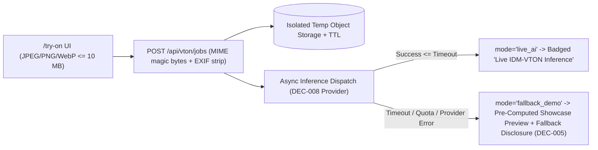

# FITLOOM — Fit Intelligence Algorithm & AI VTON Integration Spec

- **Task Reference:** `FL-P1-006` (`03_DOCUMENTATION`: `DOC-016`, `DOC-017`; governs `BE-007` and `AI-001`..`AI-009`)
- **Non-Negotiable Honesty Policy (`DEC-005`):**
  1. Fit Intelligence sizing **never** fabricates garment specs or confidence numbers when dimensions are unavailable.
  2. Virtual Try-On **never** disguises mocked or fallback previews as live IDM-VTON inference.

---

## 1. Deterministic Fit Intelligence Specification (`DOC-017`, `BE-007`)

Source implementation verified in [fit-intelligence-utils.ts](file:///C:/Users/mddan/Downloads/FITLOOM_updated/FITLOOM/FITLOOM/src/lib/fit-intelligence-utils.ts) and [mock-data.ts](file:///C:/Users/mddan/Downloads/FITLOOM_updated/FITLOOM/FITLOOM/src/lib/mock-data.ts). Both client UI and future `POST /api/fit-check` (`BE-007`) must execute identical arithmetic.

### 1.0 Canonical Unit, Precision & Conversion Rules
- **Canonical Storage Unit & Precision:** Both Body Profiles and Garment Measurements (`chest_cm`, `waist_cm`, and any future garment dimensions such as shoulder/sleeve/inseam/hip) are stored canonically in **centimeters (`numeric(6,1)`, precision `0.1 cm`)**. Monetary prices remain strict integer INR (`integer`).
- **Existing Seller FE Compatibility Note:** Current Seller catalog input schema (`SizeDimensionMapSchema` in `seller-workspace-utils.ts`) enforces whole-integer entry (`[50, 180] cm`); `numeric(6,1)` in `P3` Postgres/API supports both exact seeded integers (`.0`) and one-decimal garment specs (`0.1 cm`) without breaking existing UI behavior.
- **Imperial Conversion & Rounding:** `round1(x) = Math.round(x * 10) / 10`. Converting `in -> cm` multiplies by `2.54` (`round1`), and `cm -> in` divides by `2.54` (`round1`), matching `formatMeasureValue` and `formatCmDelta` (`fit-intelligence-utils.ts`) and `switchDraftUnit` (`body-profile-utils.ts`).

### 1.1 Fit Preference Target Ease Constants (`FIT_PREFERENCE_EASE_CM`)

| `fitPreference` | `targetEaseCm` | Geometric Intent |
| :--- | :---: | :--- |
| `slim` | `+5 cm` | Contoured torso with minimal surplus ease |
| `regular` | `+8 cm` | Standard classic drape (`DEFAULT = 8` fallback) |
| `relaxed` | `+12 cm` | Generous everyday clearance |
| `oversized` | `+15 cm` | Architectural dropped-shoulder / loose room |

### 1.2 Category-Specific Anchor Mapping
- **Trousers (`garment.category === "Trousers"`):**
  - `primaryAnchor = "waist"` (`bodyProfile.waistCm` vs `garment.waistMapCm[size]`)
  - Upper dimensions (`Chest`, `Shoulder`, `Sleeve`) -> marked `not_applicable` (`excluded from Trousers sizing`).
- **Upper-Body (`Shirts`, `Outerwear`, `T-Shirts`, `Hoodies`):**
  - `primaryAnchor = "chest"` (`bodyProfile.chestCm` vs `garment.chestMapCm[size]`)
  - Secondary check = `"waist"` (`bodyProfile.waistCm` vs `garment.waistMapCm[size]` when valid)
  - Lower dimension (`Inseam`) -> marked `not_applicable`.
- Dimensions not recorded in catalogue (`Height`, `Hip`, `Shoulder`, `Sleeve` for tops; `Height`, `Hip`, `Inseam` for trousers) remain honestly labeled `unavailable_garment_spec` in `comparisons`.

### 1.3 Candidate Evaluation & Size Selection Math
Given valid body primary dimension $B_{\text{primary}}$ and `targetEaseCm` $E_{\text{target}}$:

1. **Desired Primary Garment Circumference:**
   $$G_{\text{desired}} = \text{round}_1(B_{\text{primary}} + E_{\text{target}})$$
2. **For each candidate size $s \in \text{validSizes}$:**
   - Primary ease: $E_1(s) = \text{round}_1(G_1(s) - B_{\text{primary}})$
   - Secondary ease (if applicable & valid): $E_2(s) = \text{round}_1(G_2(s) - B_{\text{secondary}})$
   - Target distance: $\Delta(s) = \text{round}_1(|G_1(s) - G_{\text{desired}}|)$
   - **Physical Wearability Gate:** $\text{wearable}(s) \iff (E_1(s) \ge 0) \land (E_2(s) \text{ is null } \lor E_2(s) \ge 0)$
3. **Deterministic Ranking & Tie-Breaker:**
   Filter to `wearableCandidates`, sort by:
   - Ascending $\Delta(s)$ (closest primary match to $G_{\text{desired}}$)
   - Tie-break: Descending $E_1(s)$ (prefer slightly roomier ease rather than tighter squeeze)
4. **CUSTOMFIT Escalation Gate (`MAX_TARGET_DEVIATION_CM = 12`):**
   - If `bestWearable` is `null` OR $\Delta(\text{bestWearable}) > 12\text{ cm}$:
     `status = "no_supported_recommendation"`, `recommendedSize = null`, `escalateToCustomFit = true`.
   - If `garment.sizes` / `primaryGarmentMap` lacks valid specs:
     `status = "missing_garment_measurements"`, `recommendedSize = null` (never guess).

### 1.4 Zone Ease Classification (`classifyEaseVerdict`)
Let $\delta = \text{round}_1(E(s) - E_{\text{target}})$:
- $E(s) < 0$: `"Tighter than body"` (`destructive`)
- $0 \le E(s) < 2$: `"Very snug"` (`warning`)
- $|\delta| \le 3$: `"Matches preference"` (`success`)
- $\delta < -3$: `"Closer than target"` (`amber`)
- $3 < \delta \le 7$: `"Roomier drape"` (`info`)
- $\delta > 7$: `"Noticeably loose"` (`warning`)

---

## 2. Planned IDM-VTON Integration Architecture (`DOC-016`, `P4`)

> **Current Codebase State:** `/try-on` validates image MIME/size locally and renders a simulated preview explicitly badged `Visual Simulation (Mock)`. Real model inference (`AI-001`..`AI-009`) executes in Phase `P4`.

### 2.1 Async Job Lifecycle & Private Storage Handoff (`AI-005`, `AI-006`)
1. Client uploads validated photo (`image/jpeg`, `image/png`, `image/webp`, `<= 10 MB`) + `productId`.
2. Server validates MIME + binary magic bytes, strips EXIF metadata (`AI-004`), writes raw upload to **private object storage** under a non-guessable UUID key (`vton/raw/{uuid}` — never a public permanent URL), creates `vton_jobs` row (`status = "queued"`), returns `202 Accepted { jobId }`.
3. Inference worker fetches the private raw upload internally, writes any generated image to a private UUID key (`vton/out/{uuid}`), and returns **short-lived signed URLs** on `GET /api/vton/jobs/[id]` (ownership-verified against `session.user.id`). Separate background TTL jobs delete original uploads promptly and expire generated results per `[OWNER INPUT REQUIRED: Legal Retention Schedule]`.
4. Client polls `GET /api/vton/jobs/[id]` cleanly on an interval with `AbortController` / unmount cleanup.
5. **Timeout & Quota Fallback (`AI-008`, `RSK-001`):** If external inference exceeds `[TECHNICAL DECISION REQUIRED: Inference Timeout SLA, e.g. 30-45s]` or returns rate-limit `429`/upstream failure, job settles with `mode = "fallback_demo"` and serves a pre-computed garment preview accompanied by an explicit banner explaining that live IDM-VTON is unavailable and showing fallback preview (`DEC-005`).
6. **Fit Synergy (`AI-007`):** Rendered try-on panel pairs alongside `evaluateGarmentFit` recommended size + zone badges so visual inspection and anthropometric math reinforce each other.

### 2.2 Pending Technical Decision (`DEC-008`)
- `[TECHNICAL DECISION REQUIRED — Pending Owner Approval]`: Evaluate **Replicate API vs. HuggingFace Space API vs. Self-hosted GPU** during `P4` (`AI-001`/`AI-002`); recommended direction is a serverless managed inference endpoint paired with an explicit `~35s` timeout threshold triggering `mode = "fallback_demo"` (`DEC-005`). Not finalized without P4 benchmark telemetry and Owner sign-off.
