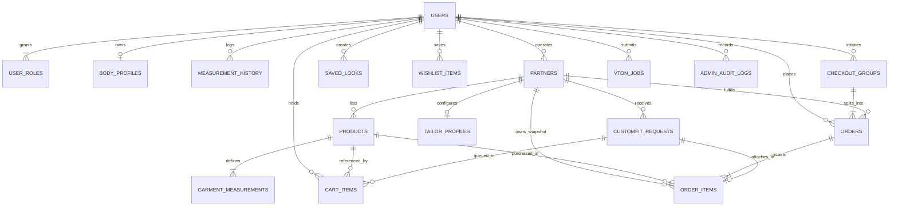

# FITLOOM — Neon PostgreSQL, Drizzle Schema, ER Diagram & API Contracts

- **Task Reference:** `FL-P1-005` (`03_DOCUMENTATION`: `DOC-013`, `DOC-014`, `DOC-015`; feeds `BE-001`..`BE-011`)
- **Planned Stack (`DEC-006`):** Neon PostgreSQL (serverless Postgres) + Drizzle ORM + Zod 3.24 + Better Auth
- **Status:** Planned Blueprint for `P3` (`0` database tables or `/api/*` routes exist in the current frontend codebase).

---

## 1. Database Architecture & Core Design Decisions (`DOC-013`)

### 1.1 Multi-Role Capability Model (`users`, `user_roles`, `partners`)
- One Better Auth `users` account holds **additive authorized capabilities** in `user_roles (user_id, role)` (`role IN ('customer', 'seller', 'tailor', 'admin')`).
- Registration automatically grants `'customer'`.
- Submitting `/api/tailor/register` requires an authenticated signed-in user (`customer` session) and inserts `partners (owner_user_id = session.user.id, type = 'tailor', verification_status = 'pending_review', operational_status = 'active')`.
- **Admin approval (`PATCH /api/admin/partners/[id]` -> `'verified'`)** grants `'tailor'` (or `'seller'`) into `user_roles` **without removing `'customer'`**, allowing an approved Tailor to use both Customer shopping and Tailor workspace capabilities from one account. Rejected applications never receive partner capabilities; suspended partners retain personal Customer access while blocked from partner APIs (`403 PARTNER_SUSPENDED`). `'admin'` is provisioned strictly out-of-band.

### 1.2 Mixed-Cart Option B Checkout Split & Payment/Refund Boundary
- **Current FE Demo vs. Planned `P3` (`Option B` Recommended — Pending Owner Approval):** In the `PH5` frontend showcase (`checkout-utils.ts`), one checkout emits one `MockOrder`. In `P3`, **Recommended Option B** preserves mixed/multi-seller checkout UX:
  1. Single customer checkout creates one **`checkout_groups`** parent (`grand_total_inr`, `shipping_snapshot`, `payment_provider`, `payment_reference`, `payment_status`).
  2. Inside one **atomic Postgres transaction (`drizzle.transaction`)**, line items split into:
     - One **`orders`** row (`fulfillment_type = 'standard'`, `seller_partner_id`, `tailor_partner_id = NULL`, `stage = 'Placed'`, `total_inr`) **per distinct Seller**.
     - One **`orders`** row (`fulfillment_type = 'customfit'`, `tailor_partner_id`, `seller_partner_id = NULL`, `customfit_request_id`, `stage = 'Pending Tailor Acceptance'`, `measurements_snapshot`, `total_inr`) **per CUSTOMFIT request**.
  3. On any validation/inventory/quote/partner error, the entire SQL transaction rolls back cleanly (`0` orphan headers/orders).
  4. **Independent Lifecycle & Refund Allocation:** Each child `orders` row tracks `allocated_amount_inr` (`= total_inr`) and `refunded_amount_inr` (`0..total_inr`) against the parent `checkout_groups` payment intent. Cancelling/rejecting one child order triggers partial refund allocation against that order only, without disrupting sibling Seller/Tailor orders. Live payment capture/split payouts remain deferred behind **`[TECHNICAL DECISION REQUIRED: Commercial Payment Gateway]`** & **`[OWNER INPUT REQUIRED]`** (Hackathon MVP runs in Demo Checkout mode matching UI).

### 1.3 Canonical Measurement Precision, Immutable Snapshots & History
- **Precision (`numeric(6,1)`):** All body (`body_profiles`, `measurement_history`) and garment dimensions (`garment_measurements.chest_cm`, `waist_cm`, and future dimensions) use canonical **metric centimeters `numeric(6,1)`** (`0.1 cm` precision; Seller UI `SizeDimensionMapSchema` whole-integer compatibility preserved), while INR money fields strictly use **`integer`**.
- **Immutable Order Snapshots:** `order_items` snapshots `product_id`, `seller_partner_id`, `product_name_snapshot`, `selected_size`, `garment_dimensions_snapshot (jsonb)`, `unit_price_inr`, `quantity`, `customfit_request_id`, and `customfit_notes`.
- **Measurement History Scope:** `measurement_history` models `{ id, user_id, chest_cm, waist_cm, note, recorded_at }` matching `FitloomProvider`'s 5-entry log, with optional `full_snapshot (jsonb)` marked strictly **Planned**.
- **Key Indexes (`BE-002`):** `users(email)` unique; `user_roles(user_id, role)` PK; `partners(owner_user_id, type)` unique; `body_profiles(user_id)` unique; `products(status, moderation_status, category)`; `garment_measurements(product_id, size)` unique; `cart_items(user_id, product_id, selected_size, COALESCE(customfit_request_id, 'standard'))` unique; `orders(checkout_group_id)`, `orders(customer_id, created_at)`, `orders(fulfillment_type, seller_partner_id, stage)`, `orders(fulfillment_type, tailor_partner_id, stage)`; `vton_jobs(user_id, status, raw_expires_at, result_expires_at)`.

---

## 2. Entity-Relationship (ER) Diagram (`DOC-014`)

---

## 3. Core Drizzle Relational Schema Blueprint (`BE-002`)

| Table | Key Columns (Aligned to `frontend/src/lib/*` & Multi-Role Option B Design) | Constraints & Notes |
| :--- | :--- | :--- |
| **`users`** | `id (uuid pk)`, `name`, `email (unique)`, `password_hash`, `account_status ('active'\|'disabled')`, `phone`, `city`, `created_at` | Better Auth canonical user identity (`BE-003`) |
| **`user_roles`** | `user_id (fk users)`, `role ('customer'\|'seller'\|'tailor'\|'admin')`, `granted_by (nullable fk users)`, `granted_at` | Composite PK `(user_id, role)`; enables Customer+Tailor/Seller multi-capability accounts |
| **`partners`** | `id (uuid pk)`, `owner_user_id (fk users)`, `type ('seller'\|'tailor')`, `name`, `city`, `verification_status ('pending_review'\|'verified'\|'rejected')`, `operational_status ('active'\|'suspended')`, `reason`, `created_at` | Unique `(owner_user_id, type)` prevents duplicate partner applications (`409`) |
| **`tailor_profiles`** | `partner_id (pk/fk partners)`, `specialties`, `base_tailoring_fee_inr (int)`, `turnaround_days (int)`, `weekly_capacity_orders (int)`, `updated_at` | Validated by `TailorWorkshopProfileSchema` |
| **`body_profiles`** | `user_id (pk/fk users)`, `height_cm (numeric 6,1)`, `weight_kg (numeric 5,1 nullable)`, `body_type (nullable)`, `chest_cm (numeric 6,1)`, `waist_cm (numeric 6,1)`, `hip_cm (numeric 6,1)`, `shoulder_cm (numeric 6,1)`, `sleeve_cm (numeric 6,1)`, `inseam_cm (numeric 6,1)`, `fit_preference`, `updated_at` | Bounds match `BodyProfileSchema` |
| **`measurement_history`** | `id (uuid pk)`, `user_id (fk users)`, `chest_cm (numeric 6,1)`, `waist_cm (numeric 6,1)`, `note`, `recorded_at`, `full_snapshot (jsonb nullable — Planned)` | Matches FE 5-entry chest/waist log; `full_snapshot` marked Planned |
| **`products`** | `id (text pk)`, `seller_partner_id (fk partners)`, `name`, `category`, `fit_type`, `occasion`, `color`, `swatch_hex`, `image_url`, `fabric`, `stretch_note`, `price_inr (int)`, `inventory_qty (int nullable)`, `status ('draft'\|'active'\|'out_of_stock'\|'inactive')`, `moderation_status ('approved'\|'rejected'\|'suspended')`, `moderation_reason`, `custom_fit_eligible (bool)`, `rating_avg (numeric 3,2)`, `review_count (int)`, `updated_at` | Seller-owned; soft-archived when referenced by `order_items` |
| **`garment_measurements`** | `id (uuid pk)`, `product_id (fk products)`, `size ('S'\|'M'\|'L'\|'XL')`, `chest_cm (numeric 6,1)`, `waist_cm (numeric 6,1)`, `extra_dims_cm (jsonb nullable)` | Unique `(product_id, size)`; canonical `0.1 cm` |
| **`saved_looks`** | `id (uuid pk)`, `user_id (fk users)`, `title`, `garment_ids (text[])`, `source ('Style Studio'\|'Virtual Try-On')`, `created_at` | Mirrors `MockSavedLook` |
| **`wishlist_items`** | `user_id (fk users)`, `product_id (fk products)`, `created_at` | Composite PK `(user_id, product_id)` |
| **`cart_items`** | `id (uuid pk)`, `user_id (fk users)`, `product_id (fk products)`, `selected_size ('S'\|'M'\|'L'\|'XL'\|'CUSTOMFIT')`, `quantity (int check 1..10)`, `customfit_request_id (nullable fk)` | Unique `(user_id, product_id, selected_size, COALESCE(customfit_request_id, 'standard'))` |
| **`customfit_requests`** | `id (text pk)`, `customer_id (fk users)`, `product_id (fk products)`, `tailor_partner_id (fk partners)`, `measurements_snapshot (jsonb)`, `fit_preference`, `adjustment_areas (text[])`, `notes`, `tailoring_fee_inr (int)`, `quote_status`, `quote_approved (bool)`, `stage`, `created_at` | `quote_approved = true` required before checkout |
| **`checkout_groups`** | `id (text pk)`, `customer_id (fk users)`, `grand_total_inr (int)`, `payment_mode ('demo'\|'gateway')`, `payment_provider (nullable)`, `payment_reference (nullable)`, `payment_status`, `shipping_address`, `shipping_city`, `shipping_state`, `shipping_pincode`, `created_at` | Single parent customer checkout/payment reference linking Option B split `orders` |
| **`orders`** | `id (text pk)`, `checkout_group_id (fk checkout_groups)`, `customer_id (fk users)`, `fulfillment_type ('standard'\|'customfit')`, `seller_partner_id (nullable fk partners)`, `tailor_partner_id (nullable fk partners)`, `customer_name`, `customer_email`, `customer_phone`, `shipping_address`, `shipping_city`, `shipping_state`, `shipping_pincode`, `payment_label`, `total_inr (int)`, `allocated_amount_inr (int)`, `refunded_amount_inr (int default 0)`, `stage (OrderStage enum)`, `rejection_reason`, `cancel_or_return_reason`, `measurements_snapshot (jsonb nullable)`, `created_at` | Check: `(fulfillment_type='standard' AND seller_partner_id IS NOT NULL AND tailor_partner_id IS NULL)` OR `(fulfillment_type='customfit' AND tailor_partner_id IS NOT NULL AND seller_partner_id IS NULL)`; check `refunded_amount_inr <= total_inr` |
| **`order_items`** | `id (uuid pk)`, `order_id (fk orders)`, `product_id (fk products)`, `seller_partner_id (fk partners)`, `product_name_snapshot`, `selected_size`, `garment_dimensions_snapshot (jsonb nullable)`, `unit_price_inr (int)`, `quantity (int)`, `customfit_request_id (nullable fk)`, `customfit_notes` | Immutable historical line snapshot |
| **`vton_jobs`** | `id (uuid pk)`, `user_id (fk users)`, `product_id (fk products)`, `source_image_key (text — private UUID)`, `result_image_key (text nullable — private UUID)`, `provider`, `mode ('live_ai'\|'fallback_demo')`, `status ('queued'\|'processing'\|'succeeded'\|'failed'\|'timed_out')`, `error_code`, `raw_expires_at`, `result_expires_at`, `created_at` | Private UUID keys only (no permanent public URLs); separate TTL expiry |
| **`admin_audit_logs`** | `id (uuid pk)`, `actor_user_id (fk users)`, `target_type ('partner'\|'product'\|'order'\|'checkout_group')`, `target_id`, `action`, `reason`, `created_at` | Append-only governance & oversight trail |
| **`contact_inquiries`** | `id (uuid pk)`, `name`, `email`, `topic`, `subject`, `message`, `created_at` | Persists `/contact` Zod submissions |

---

## 4. Zod-Aligned REST API Contracts (`DOC-015`, `BE-003`..`BE-011`)

All endpoints return `{ ok: true, data }` or `{ ok: false, error: { code, message, fieldErrors? } }`. Multi-capability users carry `capabilities[]` in Better Auth session context; each route checks its required capability & partner operational status independently.

| Endpoint | Method | Capability / Guard | Zod / Validation Contract | Key Behavior & Error Codes |
| :--- | :--- | :--- | :--- | :--- |
| `/api/health` | `GET` | Public | — | `200 { db: "ok" }` (`BE-001`) |
| `/api/auth/register` | `POST` | Public | `RegisterSchema` | Creates `users` + grants `'customer'` in `user_roles`; `201` / `409 EMAIL_EXISTS` |
| `/api/auth/login` | `POST` | Public | `LoginSchema` | `200 { user, capabilities[], partnerStatuses }` / `401 INVALID_CREDENTIALS` |
| `/api/auth/logout` | `POST` | Auth | — | `200` clears HTTP-only session cookie |
| `/api/users/me` | `GET`, `PATCH` | Auth | `ProfileFormSchema` | Returns profile, `capabilities[]`, and linked partner verification/operational status (`BE-004`) |
| `/api/body-profile` | `GET`, `PUT` | Cap: `customer` | `BodyProfileSchema` (`0.1 cm` canonical) | `200 { profile, history }` (`BE-005`) |
| `/api/products` & `/[id]` | `GET` | Public | Query: `page`, `limit`, `category`, `garmentType`, `search` / Path `id` | Eligible active/approved catalogue (`numeric 6,1` size specs) with sizes & measurements / `404 PRODUCT_NOT_FOUND` / `400 VALIDATION_ERROR` |
| `/api/fit-check` | `POST` | Cap: `customer` | `{ productId, size?, fitPreference? }` | Deterministic `FitEvaluationResult` with target ease (+5/+8/+12/+15 cm), per-size verdicts & recommended size (`BE-007`) / `422 MISSING_BODY_PROFILE` / `404 PRODUCT_NOT_FOUND` |
| `/api/vton/jobs` & `/[id]` | `POST`, `GET` | Cap: `customer` (Owner) | Multipart `image` (`<= 10 MB`, JPEG/PNG/WebP + magic bytes) | Strips EXIF, private UUID key, signed short-lived result URL + Fallback Disclosure (`DEC-005`) |
| `/api/saved-looks` & `/[id]` | `GET/POST/PATCH/DELETE` | Cap: `customer` (Owner) | `{ title, garmentIds[], source }` | `200` / `201` / `403 FORBIDDEN` (`BE-008`) |
| `/api/cart` & `/[itemId]` | `GET/POST/PATCH/DELETE` | Cap: `customer` | `{ productId, size, quantity (1..10), customfitRequestId? }` | Deterministic upsert dedupe, qty `1..10`, availability check (`BE-009`) |
| `/api/orders` | `GET`, `POST` | Cap: `customer` | `CheckoutCustomerSchema` + `paymentLabel` | Revalidates cart & server totals; Option B splits into per-Seller `standard` & per-Tailor `customfit` orders under `checkout_group_id` (`201 { checkoutGroupId, orders }`); atomic SQL rollback on failure (`400 CART_INVALID` / `409 QUOTE_UNAPPROVED`) |
| `/api/orders/[id]` | `GET`, `PATCH` | Cap: `customer` (Owner) | Action: `cancel` / `return` + `reason` | Own-order lifecycle & per-order refund allocation tracking / `404 ORDER_NOT_FOUND` |
| `/api/customfit` & `/[id]/approve` | `GET`, `POST` | Cap: `customer` | `BodyProfileSchema`, `productId`, `tailorPartnerId`, `notes` | Requires `quote_approved = true` before adding to Bag (`BE-010`) |
| `/api/seller/products` & `/[id]` | `GET/POST/PATCH/DELETE` | Cap: `seller` + Verified Active Partner | `SellerProductFormSchema` | Owner-scoped (`seller_partner_id`); soft-archives if referenced in `order_items`; `403 PARTNER_SUSPENDED` |
| `/api/seller/orders` & `/[id]` | `GET`, `PATCH` | Cap: `seller` + Verified Active Partner | `STANDARD_ORDER_STAGES` / cancel reason | Scoped strictly to `fulfillment_type='standard' AND seller_partner_id = session.sellerPartnerId`; `403 FORBIDDEN` on cross-seller or CUSTOMFIT orders |
| `/api/tailor/register` | `POST` | Cap: `customer` (Auth Required) | `TailorRegistrationSchema` | Links `owner_user_id = session.user.id`, `verification_status='pending_review'`; `401` if guest; `409 PARTNER_APPLICATION_EXISTS` if dup; retains `'customer'` access without self-granting `'tailor'` |
| `/api/tailor/orders` & `/[id]` | `GET`, `PATCH` | Cap: `tailor` + Verified Active Partner | `accept` \| `reject(reason)` \| `advance(stage)` | Scoped strictly to `fulfillment_type='customfit' AND tailor_partner_id = session.tailorPartnerId` |
| `/api/tailor/profile` | `GET`, `PUT` | Cap: `tailor` + Verified Active Partner | `TailorWorkshopProfileSchema` | Workshop profile & weekly capacity |
| `/api/admin/partners/[id]` | `PATCH` | Cap: `admin` | `{ action: verify\|reject\|suspend\|reactivate, reason? }` | `verify` inserts `'tailor'`/`'seller'` into `user_roles`; `suspend` sets `operational_status='suspended'` (preserving customer capability); appends `admin_audit_logs` |
| `/api/admin/catalogue/[id]` | `PATCH` | Cap: `admin` | `{ action: approve\|reject\|suspend\|restore, reason? }` | Enforces `AdminModerationReasonSchema` (>= 5 chars) + audit log |
| `/api/admin/orders` | `GET`, `POST` | Cap: `admin` | `GET`: read filters; `POST`: `{ orderId, note }` | Read-only cross-platform oversight (`checkout_groups` + `orders`) + append-only governance note logging; Admin has **no** stage override endpoint (`BE-011`) |
| `/api/contact` | `POST` | Public | `ContactSchema` | `201 { inquiryId }` |
| `/api/avatar/status` | `GET` | Cap: `customer` | — | `200 { status, modelReady, cudaAvailable }` / `503 SERVICE_UNAVAILABLE` (never leaks engine URL/token) |
| `/api/avatar/preset` | `POST` | Cap: `customer` | `AvatarPresetInputSchema` (`gender?`) | Generates avatar from user's saved `body_profiles`; records ownership in `avatars` table (`201 { avatarId, measurements, assets, createdAt }`) / `422 MISSING_BODY_PROFILE` / `503 SERVICE_UNAVAILABLE` |
| `/api/avatar/sizing` | `POST` | Cap: `customer` | `AvatarSizingInputSchema` | Evaluates garment ease & sizing recommendations against owned avatar (`200 { garment_type, gender, fit_preference, recommended_size, recommended_score, sizes[] }`) / `404 AVATAR_NOT_FOUND` / `503 SERVICE_UNAVAILABLE` |
| `/api/avatar/assets/[avatarId]/[file]` | `GET` | Cap: `customer` (Owner) | Path `avatarId`, `file` | Ownership-checked streaming proxy (`apose.glb`, `tpose.glb`, `measurements.json`, `garment_*.glb`); returns `404 AVATAR_NOT_FOUND` on cross-user access (never `403` to prevent enumeration) / `400 DISALLOWED_FILE` / `400 INVALID_AVATAR_ID` / `503 SERVICE_UNAVAILABLE` |

---

## 5. Standard Backend Error Codes (`DOC-021`, `BE-011`)

All Route Handlers adhere to the uniform `{ ok: false, error: { code, message, fieldErrors? } }` contract:

| Status | Code | Meaning & Typical Context |
| :--- | :--- | :--- |
| **`400`** | `VALIDATION_ERROR` | Request failed Zod schema parsing; includes `fieldErrors` map. |
| **`400`** | `BAD_REQUEST` | Malformed JSON body or invalid syntax. |
| **`400`** | `CART_INVALID` | Cart is empty, contains inactive items, or items missing seller partners during checkout. |
| **`400`** | `SIZE_UNAVAILABLE` | Selected size is not available in garment measurements for this product. |
| **`400`** | `PRODUCT_UNAVAILABLE` | Product is not active or approved for customer purchase. |
| **`400`** | `CANNOT_CANCEL_ORDER` | Order is in a stage that does not permit customer cancellation (e.g. stitching, delivered). |
| **`400`** | `ORDER_ALREADY_CANCELLED` | Order has already been cancelled. |
| **`400`** | `CANNOT_RETURN_ORDER` | Return requested on an order that has not reached Delivered stage. |
| **`400`** | `INVALID_AVATAR_ID` | Avatar ID fails 8-char hex format validation (`^[a-f0-9]{8}$`). |
| **`400`** | `DISALLOWED_FILE` | Requested asset filename is not on the engine allow-list. |
| **`401`** | `UNAUTHORIZED` | Missing or invalid Better Auth HTTP-only session cookie. |
| **`403`** | `FORBIDDEN` | Missing required capability or cross-origin CSRF violation. |
| **`403`** | `PARTNER_SUSPENDED` | Partner operational status is suspended; blocks partner-scoped endpoints. |
| **`403`** | `PARTNER_NOT_VERIFIED` | Partner application is still pending review or rejected. |
| **`404`** | `NOT_FOUND` / `AVATAR_NOT_FOUND` | Resource not found, or resource owned by another user (strict 404 to prevent enumeration). |
| **`404`** | `ASSET_NOT_FOUND` | Avatar asset file does not exist on the engine storage. |
| **`404`** | `PRODUCT_NOT_FOUND` | Product ID not found or inactive. |
| **`409`** | `EMAIL_EXISTS` / `PARTNER_APPLICATION_EXISTS` | Conflict on unique constraint (e.g. duplicate email or partner record). |
| **`413`** | `PAYLOAD_TOO_LARGE` | Request body exceeds the 1MB or 10MB limit. |
| **`415`** | `UNSUPPORTED_MEDIA_TYPE` | Content-Type header missing or not matching expected format. |
| **`422`** | `MISSING_BODY_PROFILE` | Operation requires a saved anthropometric body profile that has not been created. |
| **`429`** | `RATE_LIMITED` | Too many requests within the sliding window; includes `Retry-After` header. |
| **`500`** | `INTERNAL_ERROR` | Unhandled internal exception; logged server-side, non-leaking generic message. |
| **`503`** | `SERVICE_UNAVAILABLE` | External service (e.g. 3D avatar engine) is offline, unreachable, or timed out (`DEC-005`). |

