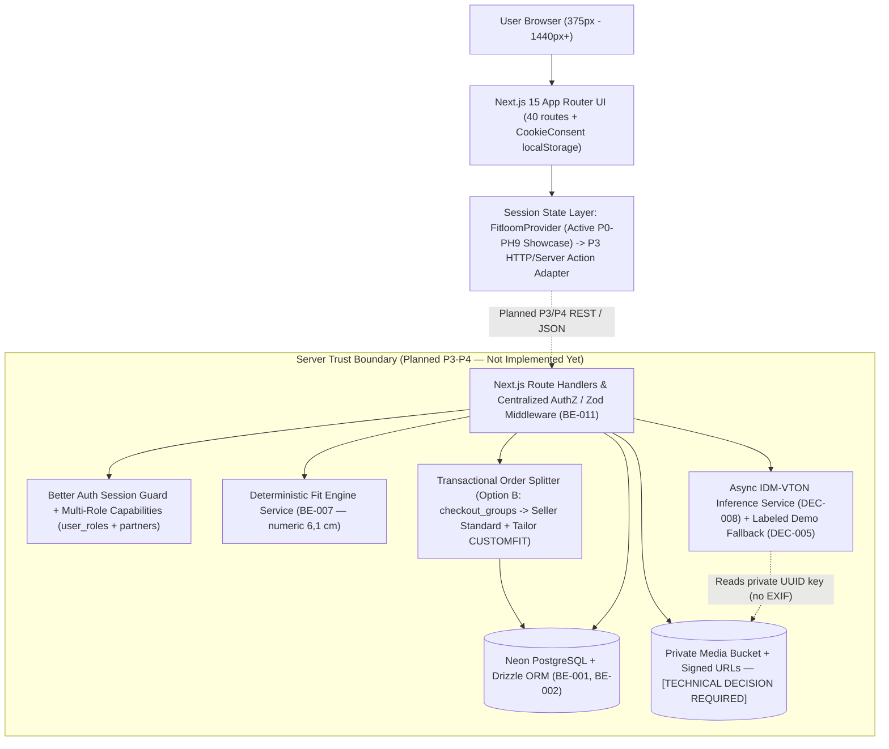

# FITLOOM — System, Frontend & Planned Backend Architecture

- **Task Reference:** `FL-P1-004` (`03_DOCUMENTATION`: `DOC-010`, `DOC-011`, `DOC-012`)
- **Decisions Locked:** `DEC-001`..`DEC-006`, `DEC-009`, `DEC-010`
- **Core Stack (`package.json` + `DEC-006`):** Next.js 15 App Router, React 19, TypeScript 5.7+, Tailwind CSS 4, Zod 3.24, GSAP, Lenis, Lucide React; Planned P3–P6: Neon PostgreSQL, Drizzle ORM, Better Auth, IDM-VTON (`DEC-008`), Vercel.

---

## 1. End-to-End Architecture & Trust Boundaries

The diagram below distinguishes the **existing verified client prototype** from the **planned P3/P4 server, storage, and AI components**:

---

## 2. Current Frontend Architecture (`src/` Source of Truth)

### 2.1 Global Shell & Visual System
- **Root Layout (`src/app/layout.tsx`) & `MainShell` (`src/components/layout/main-shell.tsx`):**
  - Wraps app in `LenisProvider`, `FitloomProvider`, `RadialBackground` (`DEC-003`), route-aware `Navbar` (delegates `/` to `HeroNavbar`), `<main>`, approved Futuristic `Footer` (`DEC-004`), `CookieConsentBanner`, and `ToastViewport`.
  - SEO metadata template `"%s | FITLOOM"` + `/icon.svg`, complemented by `33` route `layout.tsx` metadata wrappers, `7` server `page.tsx` metadata exports, `src/lib/route-metadata.ts`, [not-found.tsx](file:///C:/Users/mddan/Downloads/FITLOOM_updated/FITLOOM/FITLOOM/src/app/not-found.tsx), and [error.tsx](file:///C:/Users/mddan/Downloads/FITLOOM_updated/FITLOOM/FITLOOM/src/app/error.tsx).
- **Locked Showcase Layers (`DEC-004`):** `src/components/hero/*` (`HeroNavbar`, `HeroModels`, `BrandBackdrop`, `OutfitSelector`, `HeroContent`, `HeroFeatureStrip`) and `src/components/layout/footer.tsx`.

### 2.2 Pure Domain Modules (`src/lib/*`)
Every critical business invariant is isolated in pure TypeScript helpers + Zod schemas under `src/lib/` so P3 backend route handlers can import or mirror exact rules cleanly:
- [mock-data.ts](file:///C:/Users/mddan/Downloads/FITLOOM_updated/FITLOOM/FITLOOM/src/lib/mock-data.ts): Core domain entities (`BodyProfileSchema`, `FitPreferenceSchema`, `FIT_PREFERENCE_EASE_CM`, `MOCK_GARMENTS`, `MOCK_TAILORS`).
- [fit-intelligence-utils.ts](file:///C:/Users/mddan/Downloads/FITLOOM_updated/FITLOOM/FITLOOM/src/lib/fit-intelligence-utils.ts): Pure `evaluateGarmentFit` size calibration & zone breakdown.
- [body-profile-utils.ts](file:///C:/Users/mddan/Downloads/FITLOOM_updated/FITLOOM/FITLOOM/src/lib/body-profile-utils.ts): `cm`/`in` conversion, draft validation, Smart Estimate.
- [checkout-utils.ts](file:///C:/Users/mddan/Downloads/FITLOOM_updated/FITLOOM/FITLOOM/src/lib/checkout-utils.ts): `validateCartItems`, `CheckoutCustomerSchema`, `buildValidatedMockOrder`.
- [customfit-utils.ts](file:///C:/Users/mddan/Downloads/FITLOOM_updated/FITLOOM/FITLOOM/src/lib/customfit-utils.ts): Garment eligibility, adjustment options, quote lifecycle state machine.
- [seller-workspace-utils.ts](file:///C:/Users/mddan/Downloads/FITLOOM_updated/FITLOOM/FITLOOM/src/lib/seller-workspace-utils.ts), [tailor-workspace-utils.ts](file:///C:/Users/mddan/Downloads/FITLOOM_updated/FITLOOM/FITLOOM/src/lib/tailor-workspace-utils.ts), [admin-workspace-utils.ts](file:///C:/Users/mddan/Downloads/FITLOOM_updated/FITLOOM/FITLOOM/src/lib/admin-workspace-utils.ts): Pure state-transition validators, partner suspension logic, catalogue visibility adapter (`selectEligibleCustomerGarments`), and KPI computations.
- [workspace-config.ts](file:///C:/Users/mddan/Downloads/FITLOOM_updated/FITLOOM/FITLOOM/src/lib/workspace-config.ts): Dedicated workspace routes & `evaluateWorkspaceAccess`.

### 2.3 Centralized State Store (`FitloomProvider`)
[fitloom-provider.tsx](file:///C:/Users/mddan/Downloads/FITLOOM_updated/FITLOOM/FITLOOM/src/components/providers/fitloom-provider.tsx) holds reactive session memory for the **single-active demo role** (`MockRole = "guest" | "customer" | "seller" | "tailor" | "admin"` for previewing workspaces), body profile & 5-entry chest/waist `measurementHistory`, `sellerProducts` synced cleanly to `eligibleCustomerGarments`, cart, wishlist, saved looks, compare, orders, tailor workshop profile, partners, `adminAuditLog`, and accessible `ToastItem` queue.

---

## 3. Planned Multi-Role Capability Model & Authorization Architecture (`P3`)

### 3.1 Multi-Role Capabilities vs. Active Workspace View (`RECOMMENDED ARCHITECTURE`)
To avoid locking an approved Tailor or Seller out of Customer shopping while enforcing strict server security:
1. **Additive Multi-Capability Server Model (`user_roles` + `partners`):**
   - One Better Auth `users` account holds **multiple granted capabilities** in `user_roles` (`'customer' | 'seller' | 'tailor' | 'admin'`), with `'customer'` assigned by default at account registration.
   - An approved Tailor retains `'customer'` capability AND gains `'tailor'` upon Admin verification of their linked `partners` row (`partners.owner_user_id -> users.id`, `unique(owner_user_id, type)`).
   - **No Dual-Account Needed:** One signed-in session seamlessly accesses both Customer routes (`/shop`, `/body-profile`, `/fit-check`, `/try-on`, `/cart`, `/orders*`, `/customfit`) AND their verified Partner workspace (`/tailor*` or `/seller*`).
2. **UI Workspace Switcher vs. Server Authority:**
   - The existing `/account` role switcher & `Navbar` CTAs adapt in `P5` to switch **active UI workspace chrome only among the user's server-authorized capabilities** (`GET /api/users/me -> authorizedCapabilities[]`). Client-side switching **never** modifies server permissions or bypasses guards.
   - `admin` remains a strictly isolated, out-of-band provisioned capability; client APIs or partner approvals can never elevate a user to `admin`.
3. **Rejection & Suspension Isolation:**
   - *Application Rejected (`partners.verification_status === 'rejected'`):* Partner role is never added to `user_roles`; user retains normal `'customer'` shopping permissions; `/api/tailor/*` or `/api/seller/*` returns `403 FORBIDDEN`.
   - *Partner Suspended (`partners.operational_status === 'suspended'`):* Middleware blocks all Seller/Tailor workspace operations (`403 PARTNER_SUSPENDED`), hides suspended Seller listings from `/shop`, and halts active workshop transitions — while preserving personal `'customer'` shopping access unless the `users` account itself is globally disabled.

---

## 4. Planned Backend Architecture & Mixed-Cart Fulfillment (`P3` & `P4` — Not Yet Built)

### 4.1 API Route Layers (`src/app/api/**`)
Following `DEC-002` and `DEC-006`:
1. **Transport & Parsing Layer:** Route Handlers parse JSON/multipart payloads and run canonical **Zod schemas** matching `src/lib/*`. Invalid requests return uniform `400 VALIDATION_ERROR`.
2. **AuthN, Tailor Onboarding & Capability Guard Middleware (`BE-011`):**
   - Validates Better Auth HTTP-only session -> loads `session.capabilities` (`user_roles`) and linked `partners` rows (`owner_user_id = session.user.id`).
   - **Tailor Onboarding (`/api/tailor/register`):** Authenticated Customer submits `TailorRegistrationSchema` -> creates `partners` row (`verification_status = 'pending_review'`, duplicate `(owner_user_id, 'tailor')` returns `409`). Only Admin `PATCH /api/admin/partners/[id]` (`verify`) grants `'tailor'` capability into `user_roles` + logs `admin_audit_logs`.
3. **Domain Service Layer:**
   - `fit-service`: Runs server-side deterministic `evaluateGarmentFit` against PostgreSQL `numeric(6,1)` `garment_measurements`.
   - `catalogue-service`: Enforces `isProductEligibleForCustomerCatalog` SQL filters (`moderation_status = 'approved' AND status = 'active' AND partner.operational_status = 'active'`).
   - `order-service` (**Recommended `Option B` Checkout Splitting**):
     - **Verified Frontend Baseline vs. P3 Design Choice:** In the current `PH5` frontend showcase (`checkout-utils.ts` `buildValidatedMockOrder`), one checkout produces one `MockOrder` (`isCustomFit: cart.some(...)`), whereas `seller-workspace-utils.ts` blocks Seller mutations when `order.isCustomFit === true`.
     - **Option Evaluation (`[OWNER INPUT REQUIRED / TECHNICAL DECISION REQUIRED: Option B Auto-Split vs. Option A Block Mixed Carts]`):**
       - *Option A:* Reject checkouts combining standard + CUSTOMFIT items (`400 MIXED_CART_NOT_SUPPORTED`).
       - *Option B (Recommended):* Preserve current seamless customer Cart/Checkout UX by recording one `checkout_groups` parent row (`grand_total_inr`, shipping snapshot, payment reference) and inside one **atomic Postgres transaction (`drizzle.transaction`)** splitting items into: (i) one `standard` order (`seller_partner_id`, `stage = 'Placed'`) per distinct Seller, and (ii) one `customfit` order (`tailor_partner_id`, `customfit_request_id`, `stage = 'Pending Tailor Acceptance'`, `measurements_snapshot`) per CUSTOMFIT request. Any validation, inventory, quote-approval, or partner-status failure triggers full transaction rollback (`0` partial orders).
     - **Independent Lifecycle, Seller Scoping & Payment Boundary:** Each child `orders` row progresses & cancels independently, tracks `allocated_amount_inr` & `refunded_amount_inr` against the parent `checkout_groups` charge, is strictly scoped on `/api/seller/orders*` to `seller_partner_id`, and displays grouped under `checkout_group_id` on `/orders`. Real payment settlement/split payouts remain out of MVP scope until commercial gateway integration (`[TECHNICAL DECISION REQUIRED]`).
     - **Admin Read-Only Oversight:** `/admin/orders` reads all `checkout_groups` and child `orders` across both types and appends immutable `admin_audit_logs` notes without overriding Seller/Tailor stages.
   - `vton-service` (`P4`): Validates JPEG/PNG/WebP MIME & magic bytes (`<= 10 MB`), strips EXIF metadata, stores raw & generated outputs in private object storage under non-guessable UUID keys (served solely via short-lived signed URLs; zero permanent public URLs), enforces independent raw vs. result TTL cleanup, dispatches async IDM-VTON inference (`DEC-008`), and emits labeled Fallback Demo (`DEC-005`) on timeout/failure.

### 4.2 Mock-to-API Transition Strategy (`P5` Integration Path)
- Keep UI page components calling `useFitloom()` context hooks.
- Swap `FitloomProvider` setters incrementally to call `fetch("/api/...")` DTOs, replace `switchRole` mock bypass with `switchWorkspaceView` across `authorizedCapabilities[]`, and hydrate seed data (`DPY-004`) cleanly.

---

## 5. Pending Architecture & Owner Decisions Register

| Decision Ref | Topic | Recommended Approach & Rationale | Dependencies | Approval Status |
| :--- | :--- | :--- | :--- | :--- |
| **`Role Model`** | Customer + Partner Multi-Role Architecture | Additive `user_roles` + `partners(owner_user_id)` allowing approved Tailors/Sellers to retain Customer access & switch active workspace view cleanly without creating a second account. | `BE-003`, `BE-011`, Better Auth session claims | **Recommended · Pending Owner Approval** |
| **`Mixed Cart`** | `Option B` Checkout Split vs. `Option A` | **Option B:** `checkout_groups` parent + atomic Postgres split into per-Seller `standard` and per-Tailor `customfit` `orders`. Preserves FE UX and clean Seller/Tailor ownership. | Transaction rollback, `order_items` snapshots, Payment allocation rules | **Recommended · Pending Owner Approval** |
| **`DEC-008`** | IDM-VTON Inference Provider & Timeout SLA | Evaluate **Replicate API** vs. **HuggingFace Space** vs. **Self-hosted GPU** in `P4` (`AI-001`), targeting serverless reliability + `~35s` timeout fallback (`DEC-005`). | `AI-001`, `AI-002`, external quota/latency telemetry | **Pending Owner Approval** *(Evaluated in `P4`)* |
| **`Storage`** | Private Object Storage Provider | **Cloudflare R2** (or AWS S3 Private Bucket) for zero-egress private UUID object keys, native short-lived signed URLs, and TTL auto-purge rules. | `[OWNER INPUT REQUIRED: Legal Retention Schedule]`, `AI-004` | **Recommended · Pending Owner Approval** |
| **`Rate Limit`** | Rate-Limiting Store | **Upstash Redis** (serverless sliding-window limiter for Vercel Edge/Node) with low-overhead fallback to **Neon Postgres rate-limit table** under hackathon minimalism (`DEC-002`). | `P6` Vercel hosting, VTON/auth throttle limits | **Recommended · Pending Owner Approval** |
| **`History Scope`** | Measurement History (5-Entry vs. 7-Dim) | Keep implemented **`{ date, chest_cm, waist_cm, note }`** model in `P3` MVP (matches `FitloomProvider`); keep nullable `full_snapshot (jsonb)` in schema marked **Planned** post-MVP. | Existing `/body-profile` history UI | **Recommended · Pending Owner Approval** |
| **`Payments`** | Commercial Payment Gateway | Retain explicit **Demo Checkout Settlement** for Hackathon `P3`–`P6` MVP; recommend **Razorpay (INR)** or **Stripe** with `checkout_groups` parent intent + partial refund allocation for commercial launch. | `[OWNER INPUT REQUIRED: Business KYC, Settlement & Refund Terms]`, Option B `checkout_groups` | **Pending Owner Approval · Blocked** *(for live commercial mode; Demo Unblocked)* |
| **`DEC-007`** | Team Role Assignments (`09_TEAM`) | Assign Team PARADOX primary owners across FE integration, Backend (`P3`), AI (`P4`), QA/Deploy (`P5`–`P6`). | Team PARADOX confirmation (`RSK-006`) | **Pending Owner Approval · Blocked** *(for `P3` Kickoff)* |
